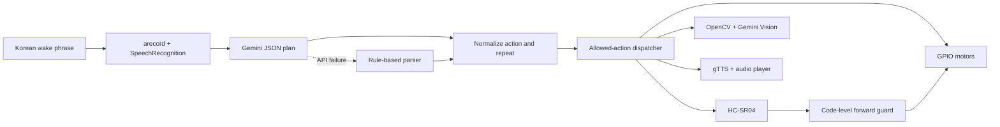

[English](README.en.md) | [한국어](README.md) | [日本語](README.ja.md)

# Gemini Raspberry Pi Robot

> A Raspberry Pi 5 robot that listens, inspects its surroundings, plans allowed actions with Gemini, and moves through a guarded hardware layer.

[Project story (Korean)](docs/ko/project-story.md) · [Architecture](docs/architecture.md) · [Setup](docs/raspberry-pi-setup.md) · [Wiring](docs/wiring.md) · [Publication checklist](docs/publication-checklist.md)

<p align="center">
  
</p>

## Overview

This individual project replaced a regular assignment in an IoT course. After considering an assistive cane, a breath analyzer, and a person-detection web app, the project moved toward a more compelling idea: combine Raspberry Pi hardware with an LLM API to build a robot that can inspect a situation, choose an action, and move.

The robot waits for a Korean wake phrase, records speech, converts it to text, and asks Gemini for a JSON sequence made only from supported actions. The application normalizes that plan and dispatches it to GPIO motors, an HC-SR04 sensor, a USB camera, or speech output. Camera questions and object navigation use Gemini Vision.

## Source restoration

The repository was republished with a new Git root on July 9, 2026. That snapshot accidentally included an early function-calling experiment instead of the final May 28 hardware integration used for the class presentation. The recordings showed real movement, vision, sensing, and speech, while the public files contained print-only stubs.

On August 9, the final `robot_pj_long_listen` backup was located and its `main_brain.py`, `actions.py`, and `hardware.py` were restored. Old backups containing a revoked credential were not used. The current source reads credentials only from `.env` or the process environment.

## Implemented capabilities

| Area | Current public source |
| --- | --- |
| Voice commands | Records with `arecord` and transcribes Korean with Google Speech Recognition |
| Planning | Gemini returns a JSON `steps` array containing supported actions |
| Fallback | A rule-based parser handles commands when Gemini is unavailable |
| Sequential motion | Forward, backward, left, right, turn-around, and stop with bounded repetition |
| Distance | Reads HC-SR04 three times and uses the median |
| Forward guard | Rechecks distance and blocks forward motion within 25 cm by default |
| Continuous approach | Polls the sensor and stops at 18 cm by default |
| Camera | Captures USB camera frames with OpenCV |
| Vision | Gemini Vision checks objects, positions, and visual conditions |
| Object approach | Alternates vision, alignment, and short movement for at most seven steps |
| Speech | Generates Korean TTS and plays it with `mpg123` or `ffplay` |
| Status LED | Shows idle, listening, and processing state on GPIO25 |

## Runtime flow



Gemini never receives direct GPIO access. It proposes supported action names and parameters; `RobotActions` validates and dispatches them to `RobotHardware`. Forward movement also checks a fresh distance value in code rather than relying only on a prompt.

## Demo recordings

| Recording | Demonstrated behavior |
| --- | --- |
| [Approaching an obstacle](https://youtu.be/QIJOv5Q-LHc) | Ultrasonic distance checks and guarded movement |
| [Inspecting an object and moving](https://youtu.be/0o1b3L9IwOY) | Camera, Gemini Vision, and motor control |
| [Audio output](https://youtu.be/ix_nwpkvWfA) | TTS and speaker playback |
| [Repeated forward and backward motion](https://youtube.com/shorts/KLmq6Mq9xEY?feature=share) | Sequential actions and repetition |
| [Inspecting after movement](https://youtube.com/shorts/O0WwkEZf5KQ?feature=share) | Fresh capture and visual response after movement |

## Hardware and BCM pins

- Raspberry Pi 5, L298N, two-wheel DC chassis, separate motor supply
- HC-SR04, USB camera, USB microphone and speaker, status LED

| Device | BCM GPIO |
| --- | --- |
| L298N IN1 / IN2 | 5 / 6 |
| L298N IN3 / IN4 | 16 / 26 |
| HC-SR04 TRIG / ECHO | 23 / 24 |
| Status LED | 25 |

Protect GPIO24 from the HC-SR04 ECHO pin's typical 5 V level with a divider or level shifter. Read the [wiring guide](docs/wiring.md) before connecting hardware.

## Quick start

```bash
git clone https://github.com/cora1022/gemini-raspberry-pi-robot.git
cd gemini-raspberry-pi-robot
python3 -m venv .venv
source .venv/bin/activate
python -m pip install --upgrade pip
pip install -r requirements.txt
cp .env.example .env
```

Set at least:

```text
GOOGLE_API_KEY=your-google-api-key
GEMINI_MODEL=gemini-2.5-flash
```

Check command planning without initializing hardware:

```bash
python test_case.py
```

Run the physical robot only after completing the setup and wiring checks:

```bash
python main_brain.py
```

`main_brain.py` initializes GPIO and the camera immediately. Keep the wheels off the floor and prepare a physical power cutoff during the first run.

## Files

| File | Responsibility |
| --- | --- |
| `main_brain.py` | Wake phrase, voice retry, and the runtime loop |
| `actions.py` | Gemini planning, fallback parser, dispatch, vision, and object navigation |
| `hardware.py` | GPIO motors, HC-SR04, LED, camera, recording, STT, and TTS |
| `test_case.py` | Planning scenarios that do not initialize physical hardware |
| `2main_brain.py` | Legacy function-calling experiment, not the current entrypoint |

## Safety and limitations

- The code has forward distance checks, but a physical emergency stop is still required.
- An ultrasonic timeout is treated as open space at the configured maximum distance; it cannot always distinguish open space from a disconnected sensor.
- Backward and turning motion have no rear or side sensors.
- Gemini Vision, speech recognition, and gTTS depend on network latency.
- The rule fallback is a minimal path for simple commands and does not parse multi-action language as reliably as Gemini.
- Camera and USB audio indices vary by device order.
- Optional music files are intentionally excluded from the repository.
- Automated hardware tests and a physical emergency-stop input are not implemented.

See [Architecture](docs/architecture.md), [Raspberry Pi setup](docs/raspberry-pi-setup.md), [Wiring](docs/wiring.md), and the [Publication checklist](docs/publication-checklist.md) for details.
