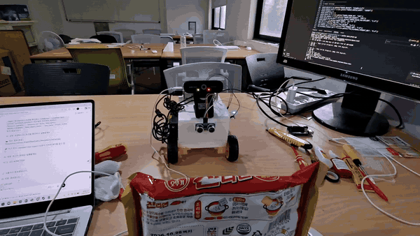
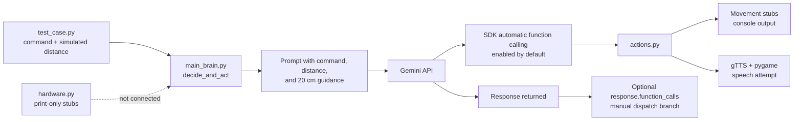

[English](README.en.md) | [한국어](README.md)

# Gemini Raspberry Pi Robot

> A public function-calling experiment derived from a physical Raspberry Pi robot prototype.

[Project Status](#project-status) · [Quick Start](#quick-start) · [Demo](#demo) · [Architecture](docs/architecture.md) · [Hardware Setup](docs/raspberry-pi-setup.md)

<p align="center">
  
</p>

## Project Status

This repository documents a physical robot prototype and publishes a smaller, reproducible experiment for studying Gemini function calling. The public Python code sends a natural-language command and a caller-supplied distance value to Gemini and supplies a limited set of Python action functions as tools.

The public source is **not a complete hardware control package**. Camera capture, ultrasonic sensor reads, GPIO motor control, microphone input, and the integrated `robot` object used during earlier prototype work are not included in the current executable path.

| Area | Current public repository status |
| --- | --- |
| Gemini function calling | Implemented in `main_brain.py` |
| Tool execution mode | Python callables are passed directly; current `google-genai` enables automatic function calling by default |
| Reproducible example | Three API-backed scenarios in `test_case.py` |
| Forward, spin, and stop actions | Console-output stubs in `actions.py` |
| Speech output | Implemented with gTTS and pygame; requires network and a working audio device |
| Distance input | Supplied as a number by `test_case.py`; no sensor read is implemented |
| 20 cm obstacle rule | Written in the Gemini prompt only; not enforced by application code |
| Camera and image input | Not implemented in the current public Python code |
| GPIO and motor control | Not implemented in the current public Python code |
| `hardware.py` | Contains print-only stubs and is not imported by `main_brain.py` |
| `2main_brain.py` | Legacy, non-runnable reference; it depends on symbols absent from `actions.py` |

## Public Repository Scope

The code in this repository currently demonstrates:

- declaring `move_forward`, `spin_around`, `stop_moving`, and `speak` as Gemini tools;
- combining a natural-language command with a simulated distance value;
- letting the Python SDK automatically execute supplied callables under its current default behavior;
- inspecting the returned response and attempting manual dispatch if `response.function_calls` is still present;
- printing virtual movement results; and
- optionally generating and playing Korean speech through gTTS and pygame.

It does not include the complete software used to connect the physical prototype's camera, sensor, motors, or microphone. The wiring and hardware documents are integration references, not proof that the current public code drives those devices.

## Physical Prototype vs Public Code

| Capability | Physical prototype and demo recordings | Current public code |
| --- | --- | --- |
| Natural-language decisions | Demonstrated | Reproducible through Gemini API calls |
| Multi-step physical movement | Shown in recordings | Gemini may return multiple calls, but movement functions only print messages |
| Camera inspection | Shown in recordings | No camera import, capture, or image input path |
| Ultrasonic sensing | Shown in recordings | Distance is manually supplied by the caller |
| Motor and GPIO control | Shown in recordings | No GPIO library or motor driver implementation |
| Speech | Shown in recordings | gTTS and pygame path is present; device support varies by environment |
| Obstacle interlock | Prototype behavior is shown in recordings | The 20 cm rule is prompt guidance, not a code-level interlock |

The videos are evidence of prototype experiments. They should not be interpreted as a claim that every recorded hardware feature can be reproduced from this public snapshot alone.

## Current Function-Calling Flow



See [Architecture](docs/architecture.md) for the verified call sequence and [한국어 아키텍처 문서](docs/ko/architecture.md) for a detailed discussion of the current boundary and a separately labeled future design.

## Quick Start

### 1. Clone and create a virtual environment

```bash
git clone https://github.com/cora1022/gemini-raspberry-pi-robot.git
cd gemini-raspberry-pi-robot
python3 -m venv .venv
source .venv/bin/activate
python -m pip install --upgrade pip
pip install -r requirements.txt
cp .env.example .env
```

On Windows PowerShell, activate the environment with:

```powershell
.\.venv\Scripts\Activate.ps1
```

### 2. Configure the environment

Edit `.env` and set a valid Gemini API key:

```text
GOOGLE_API_KEY=your-google-api-key
GEMINI_MODEL=gemini-2.5-flash
```

Keep the real key in `.env`. The repository ignores that file and tracks only `.env.example`.

### 3. Run the reproducible example

```bash
python test_case.py
```

`test_case.py` runs three scenarios: a forward request with 100 cm of simulated clearance, a forward request with a simulated obstacle at 15 cm, and a spin request at 50 cm. Each scenario makes a real Gemini API request, so network access, API credentials, quota, and possibly billing are required. Model output is nondeterministic, and the 15 cm scenario is not protected by a code-level block. Because Python callables are supplied directly and automatic function calling is not disabled, the current SDK can execute them during `generate_content` before `main_brain.py` inspects the returned response.

Running the following command does **not** start an interactive robot test:

```bash
python main_brain.py
```

`main_brain.py` currently loads configuration, creates the Gemini client, defines `decide_and_act`, and then exits because it has no command-line entrypoint.

## Demo

The following recordings show physical prototype experiments. Some recorded capabilities—especially camera inspection, sensor reads, and motor control—are outside the current public code scope.

| Demo | What the recording shows |
| --- | --- |
| <a href="https://youtu.be/QIJOv5Q-LHc"></a> | **Approaching an obstacle**<br>A physical movement and distance-aware prototype test. |
| <a href="https://youtu.be/0o1b3L9IwOY"></a> | **Inspecting an object and moving**<br>A camera-assisted prototype test. Camera code is not included here. |
| <a href="https://youtu.be/ix_nwpkvWfA"></a> | **Playing audio**<br>A speaker output experiment. |
| <a href="https://youtube.com/shorts/KLmq6Mq9xEY?feature=share"></a> | **Repeating movement**<br>A multi-action physical prototype test. |
| <a href="https://youtube.com/shorts/O0WwkEZf5KQ?feature=share"></a> | **Inspecting after movement**<br>A camera and movement prototype test. Image handling is not included here. |

## Hardware Used in the Prototype

- Raspberry Pi 5
- L298N motor driver
- Two-wheel DC motor chassis with a separate motor power supply
- HC-SR04 ultrasonic distance sensor
- USB camera
- Microphone and speaker or USB audio device

These components describe the prototype and intended integration. The current source does not contain a verified GPIO pin map or executable drivers for them. Read the [hardware setup](docs/raspberry-pi-setup.md) and [wiring guide](docs/wiring.md) before writing or connecting a hardware layer.

## Project Structure

| Path | Verified responsibility |
| --- | --- |
| `main_brain.py` | Creates the Gemini client, supplies four Python callables as tools, and implements `decide_and_act(command, distance)`. |
| `actions.py` | Implements gTTS/pygame speech and print-only forward, spin, and stop functions. |
| `hardware.py` | Contains a second set of print-only stubs; it is not connected to the primary flow. |
| `test_case.py` | Calls `decide_and_act` with three simulated command/distance scenarios. |
| `2main_brain.py` | Retained legacy experiment; currently fails because `robot` and `move_backward` are absent. |
| `docs/` | English integration notes and Korean detailed documentation. |

## Current Limitations

- There is no command listener, speech recognition loop, or interactive CLI in the primary path.
- Distance values are not read from an HC-SR04; they are passed directly into `decide_and_act`.
- The 20 cm rule is prompt text. Gemini can still return `move_forward`, and no application guard blocks it.
- Movement functions do not control GPIO or motors.
- `hardware.py` is not imported or called by `main_brain.py` or `actions.py`.
- No Python file captures camera frames or sends images to Gemini.
- `speak` depends on Google TTS network access and a working pygame audio device.
- `test_case.py` makes live model calls rather than deterministic unit tests.
- Automatic function calling is not explicitly configured, and `google-genai` is not version-pinned; tool execution and returned response details can vary with the installed SDK.
- A manual `response.function_calls` branch remains after the SDK's default automatic calling path, so the intended execution ownership is not clearly separated.
- `2main_brain.py` is not runnable in the current repository state.

## Safety Notes

- Treat all Gemini output as untrusted control input.
- Do not connect the current action stubs directly to motors without adding deterministic validation, duration limits, an emergency stop, and a code-level distance interlock.
- Prompt instructions are not safety mechanisms. Sensor checks must be performed by application code immediately before motor execution.
- Power motors separately from the Raspberry Pi and share ground only as required by the driver design.
- Protect Raspberry Pi GPIO from the HC-SR04 ECHO pin's typical 5 V level with an appropriate divider or level shifter.
- Raise the wheels off the floor for the first hardware test and keep a physical power cutoff within reach.
- Never commit `.env`, API keys, Wi-Fi credentials, recorded voices, or private camera images.

## Documentation

### English

- [Architecture](docs/architecture.md)
- [Raspberry Pi setup](docs/raspberry-pi-setup.md)
- [Wiring guide](docs/wiring.md)
- [Publication checklist](docs/publication-checklist.md)

### 한국어

- [전체 한국어 README](README.md)
- [아키텍처](docs/ko/architecture.md)
- [Raspberry Pi 설정](docs/ko/raspberry-pi-setup.md)
- [배선 가이드](docs/ko/wiring.md)
- [공개 전 체크리스트](docs/ko/publication-checklist.md)

## Build Gallery

| Controller | Chassis | Wiring |
| --- | --- | --- |
|  |  |  |
