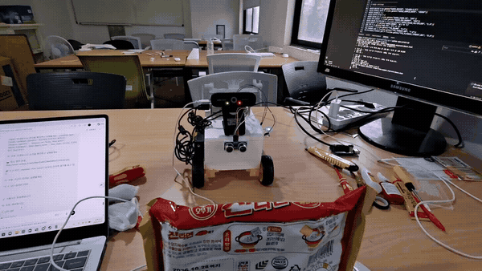
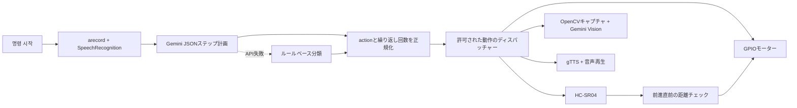

[English](README.en.md) | [한국어](README.md) | [日本語](README.ja.md)

# Gemini Raspberry Pi Robot

> 音声コマンドを理解し、周囲を確認して、許可された物理動作を実行するRaspberry Pi 5ロボット。

[開発の背景](docs/ja/project-story.md) | [アーキテクチャ](docs/ja/architecture.md) | [セットアップと実行](docs/ja/raspberry-pi-setup.md) | [配線](docs/ja/wiring.md) | [公開前チェック](docs/ja/publication-checklist.md)

<p align="center">
  
</p>

## プロジェクト概要

IoT（モノのインターネット）の授業で、課題の代わりに制作した個人プロジェクトです。視覚障害者向けの杖、アルコール検知器、人を検知するWebアプリなど、複数のテーマを検討した末、Raspberry PiとLLM APIを組み合わせて、**自ら状況を確認して判断し、その後に動くロボット**を作ることにしました。

ユーザーが「명령 시작」と話すと、ロボットは韓国語の音声を録音して認識します。Geminiはコマンドを許可された動作のみで構成されるステップ一覧に変換し、アプリケーションはその結果を検証してから、モーター、超音波センサー、カメラ、スピーカーの各機能を呼び出します。カメラを使った質問と物体への接近にはGemini Visionを使用します。

## ソース復元の記録

2026年7月9日に公開リポジトリを新しいGit履歴で整理した際、5月28日に保存した発表用の最終統合ファイルではなく、初期のfunction calling実験ファイルを公開してしまいました。映像には実機の動作が映っていましたが、当時の公開コードには出力用のスタブしか含まれておらず、両者に差異がありました。

2026年8月9日にローカルバックアップの`robot_pj_long_listen`を確認し、発表で使用した`main_brain.py`、`actions.py`、`hardware.py`を復元しました。復元時には、失効済みのAPIキーが残っていた過去のバックアップは使用していません。現在のリポジトリでは、キーを`.env`または環境変数からのみ読み込みます。詳しい経緯は[プロジェクトストーリー](docs/ja/project-story.md)に記録しています。

## 実装済みの機能

| 領域 | 現在の公開コード |
| --- | --- |
| 音声コマンド | `arecord`で録音し、Google Speech Recognitionで韓国語をテキストに変換 |
| コマンド計画 | Geminiが許可されたactionで構成されるJSONの`steps`配列を生成 |
| 代替判断 | Geminiの呼び出しに失敗した場合は、ルールベースのコマンド分類器を使用 |
| 連続動作 | 前進、後退、左右への旋回、180度旋回、停止を順序と繰り返し回数に従って実行 |
| 距離測定 | HC-SR04を3回読み取り、有効な測定値があればその中央値を使用 |
| 前進の制限 | 前進直前に距離を測定し、デフォルトでは25cm以内の場合にコード上で中止 |
| 障害物への前進 | センサーを繰り返し確認しながら進み、デフォルトでは障害物の18cm手前で停止 |
| カメラ | OpenCVでUSBカメラのフレームをJPEGとしてキャプチャ |
| 視覚判断 | Gemini Visionで物体の有無、位置、条件を満たしているかを判断 |
| 物体への接近 | 対象を探し、左右の位置合わせと短い前進を繰り返し、最大7ステップで停止 |
| 音声出力 | gTTSで生成した音声を`mpg123`または`ffplay`で再生 |
| ステータスLED | 待機、コマンド受信、処理の状態をGPIO25のLEDで表示 |

## 実行フロー



GeminiがGPIOを直接操作することはありません。モデルは許可されたaction名と繰り返し回数を提案し、`RobotActions`がそれらを正規化した後、`RobotHardware`のメソッドだけを呼び出します。前進時の距離条件はプロンプトだけに依存せず、`hardware.py`の条件分岐でも検査します。

詳しい呼び出し順序は[アーキテクチャ文書](docs/ja/architecture.md)を参照してください。

## デモ映像

| 映像 | 確認できる動作 |
| --- | --- |
| <a href="https://youtu.be/QIJOv5Q-LHc"></a> | **障害物への接近**<br>超音波による距離確認と前進停止 |
| <a href="https://youtu.be/0o1b3L9IwOY"></a> | **物体確認後の移動**<br>カメラ、Gemini Vision、モーター動作の連携 |
| <a href="https://youtu.be/ix_nwpkvWfA"></a> | **音声再生**<br>TTSとスピーカー出力 |
| <a href="https://youtube.com/shorts/KLmq6Mq9xEY?feature=share"></a> | **前進と後退の繰り返し**<br>複数のステップと繰り返し回数を実行 |
| <a href="https://youtube.com/shorts/O0WwkEZf5KQ?feature=share"></a> | **移動後の視覚判断**<br>現在位置で新しいフレームをキャプチャして回答 |

## ハードウェア

- Raspberry Pi 5
- L298Nモータードライバー
- 2輪DCモーターシャーシと独立したモーター電源
- HC-SR04超音波センサー
- USBカメラ
- USBマイクとスピーカー
- コマンド状態LED

コードで使用するBCM GPIOは次のとおりです。

| デバイス | BCM GPIO |
| --- | --- |
| L298N IN1 / IN2 | 5 / 6 |
| L298N IN3 / IN4 | 16 / 26 |
| HC-SR04 TRIG / ECHO | 23 / 24 |
| ステータスLED | 25 |

HC-SR04のECHOは通常5Vの信号を出力する場合があるため、Raspberry PiのGPIO24へ直接接続せず、抵抗分圧回路またはレベルシフターを使用してください。すべての配線と初回テストの手順は[配線文書](docs/ja/wiring.md)を確認してください。

## クイックスタート

### 1. インストール

```bash
git clone https://github.com/cora1022/gemini-raspberry-pi-robot.git
cd gemini-raspberry-pi-robot
python3 -m venv .venv
source .venv/bin/activate
python -m pip install --upgrade pip
pip install -r requirements.txt
cp .env.example .env
```

Raspberry Pi OSのシステムパッケージとデバイスの確認手順は[セットアップ文書](docs/ja/raspberry-pi-setup.md)にまとめています。

### 2. 環境変数

`.env`で、少なくとも次の値を設定します。

```text
GOOGLE_API_KEY=your-google-api-key
GEMINI_MODEL=gemini-2.5-flash
```

カメラ番号、USBオーディオデバイス、移動時間、安全距離は`.env.example`の項目で調整できます。実際のAPIキーが含まれる`.env`はGitに追加しないでください。

### 3. ハードウェアを使わずにコマンド計画を確認

```bash
python test_case.py
```

このファイルはモーター、センサー、カメラ、マイクを初期化せず、コマンド計画だけを確認します。APIキーがない場合は、ルールベースの代替分類器が動作します。

### 4. 実機ロボットを実行

```bash
python main_brain.py
```

`main_brain.py`は実行直後にGPIOとカメラを初期化し、音声待機ループを開始します。初回実行時は車輪を床から浮かせ、別途電源を遮断できる手段を用意した状態で進めてください。

## ファイルの役割

| ファイル | 役割 |
| --- | --- |
| `main_brain.py` | ウェイクワード、音声コマンドの再試行、全体の実行ループ |
| `actions.py` | Geminiによる計画、ルールベースの代替分類、ステップ実行、Vision、物体への接近 |
| `hardware.py` | GPIOモーター、HC-SR04、LED、USBカメラ、録音、STT、TTS |
| `test_case.py` | ハードウェアなしでコマンド計画を確認するシナリオ |
| `2main_brain.py` | 以前のfunction calling実験。現在の実行経路ではないレガシー参考ファイル |
| `.env.example` | 動作時間、距離、カメラ、オーディオ設定の例 |

## 安全上の注意と現在の制限事項

- 前進直前の距離チェックと連続前進中のセンサー確認は実装されていますが、物理的な緊急停止装置は別途用意する必要があります。
- HC-SR04の3回測定で有効値がなく、タイムアウトだけが発生した場合は、前方が空いているものとしてデフォルトの400 cmで処理します。タイムアウトには、ECHOの立ち上がりまたは立ち下がり待ちの超過と、測定範囲外の値が含まれます。センサーの断線と広い空間を完全に区別することはできません。
- 旋回と後退には後方または側面センサーがないため、周囲に十分な空間を確保してください。
- Gemini Vision、音声認識、gTTSは、ネットワークの状態によって遅延する場合があります。
- ルールベースの代替分類器は、単純なコマンドに対して最低限の動作を行うための経路であり、複数の動作が混在する複雑な文をGeminiと同じ水準で解釈することはできません。
- カメラ番号とUSBオーディオデバイス名は、Raspberry Piへの接続順によって変わる場合があります。
- 音楽再生機能はローカルの`music/`フォルダーにあるファイルを使用します。著作権上の理由から、音源はリポジトリに含めていません。
- 自動ハードウェアテストと物理的な緊急停止入力はまだありません。
- `2main_brain.py`は記録保存用であり、現在のランタイムとは互換性がありません。

## 詳細文書

- [開発の背景と公開コードの復元](docs/ja/project-story.md)
- [現在のアーキテクチャ](docs/ja/architecture.md)
- [Raspberry Piのセットアップと実行](docs/ja/raspberry-pi-setup.md)
- [配線と初回テスト](docs/ja/wiring.md)
- [公開前チェックリスト](docs/ja/publication-checklist.md)

## 制作時の写真

| 制御部 | シャーシ | 配線 |
| --- | --- | --- |
|  |  |  |

<p align="center">
  
</p>
