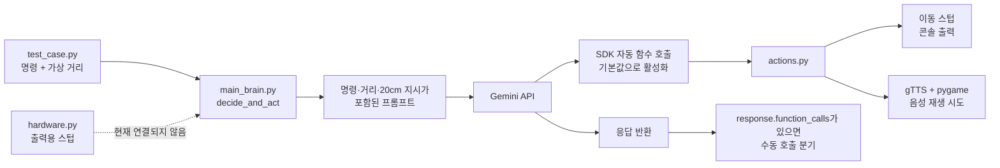

[English](README.md) | [한국어](README.ko.md)

# Gemini Raspberry Pi Robot

> 실물 Raspberry Pi 로봇 프로토타입에서 출발한 Gemini function calling 공개 실험입니다.

[프로젝트 상태](#프로젝트-상태) · [설치와 실행](#설치-방법) · [데모](#데모-영상) · [아키텍처](docs/ko/architecture.md) · [하드웨어 설정](docs/ko/raspberry-pi-setup.md)

<p align="center">
  
</p>

## 프로젝트 소개

이 프로젝트는 자연어 명령과 주변 상태를 Gemini에 전달하고, 모델이 미리 등록된 함수 중 필요한 행동을 선택하도록 구성한 Raspberry Pi 로봇 실험입니다. 실물 프로토타입에서는 모터 이동, 초음파 센서, 카메라, 스피커를 조합한 동작을 실험했고 그 결과를 GIF와 영상으로 남겼습니다.

현재 공개 저장소는 실물 로봇 전체 제어 코드를 제공하지 않습니다. 공개 코드로 재현할 수 있는 핵심은 **자연어 명령과 가상 거리 값을 Gemini에 전달하고, 제한된 Python 함수를 도구로 제공하는 판단 흐름**입니다. 카메라 입력, 실제 센서 읽기, GPIO 모터 제어와 음성 명령 수집 코드는 포함되어 있지 않습니다.

## 프로젝트 상태

| 구분 | 현재 공개 저장소 상태 |
| --- | --- |
| Gemini function calling | `main_brain.py`에 구현됨 |
| 도구 실행 방식 | Python 함수를 직접 전달하며, 현재 `google-genai` 기본값에서는 자동 함수 호출이 활성화됨 |
| 실행 가능한 예제 | `test_case.py`의 세 가지 Gemini API 호출 시나리오 |
| 전진·회전·정지 | `actions.py`에서 메시지만 출력하는 스텁 |
| 음성 출력 | gTTS로 MP3를 만들고 pygame으로 재생을 시도함 |
| 거리 입력 | `test_case.py`가 숫자를 직접 전달하며 센서 읽기는 없음 |
| 20cm 장애물 조건 | Gemini 프롬프트에만 적혀 있고 코드가 강제하지 않음 |
| 카메라·이미지 입력 | 현재 공개 Python 코드에 없음 |
| GPIO·모터 제어 | 현재 공개 Python 코드에 없음 |
| `hardware.py` | 출력용 스텁이며 주 실행 경로에서 사용되지 않음 |
| `2main_brain.py` | 누락된 `robot`, `move_backward`에 의존해 현재 실행 불가 |

## 핵심 아이디어

Gemini에 운영체제나 GPIO를 직접 조작할 권한을 주는 대신, 애플리케이션이 허용한 함수 목록을 도구로 제공합니다. 현재 등록되는 함수는 다음 네 개입니다.

- `move_forward(duration)`: 요청받은 전진 시간을 출력합니다.
- `spin_around()`: 제자리 회전 동작을 출력합니다.
- `stop_moving()`: 정지 동작을 출력합니다.
- `speak(text)`: gTTS와 pygame으로 한국어 음성 재생을 시도합니다.

이 구조는 모델의 판단과 실제 장치 제어 사이에 애플리케이션 경계를 둘 수 있다는 점을 보여줍니다. 다만 현재 코드에는 함수 인자 검증, 최대 동작 시간 제한, 센서 기반 차단, 긴급 정지와 같은 실제 하드웨어용 안전 계층이 아직 없습니다.

## 현재 공개 코드의 구현 범위

공개 코드로 확인하고 실행할 수 있는 범위는 다음과 같습니다.

1. `.env`에서 Gemini API 키와 모델명을 읽습니다.
2. `main_brain.py`가 네 개의 Python 함수를 Gemini 도구로 등록합니다.
3. `decide_and_act(user_command, distance)`가 명령과 호출자가 제공한 거리 값을 프롬프트로 만듭니다.
4. 현재 `google-genai` 기본 동작에서는 전달된 Python 함수를 SDK가 자동으로 호출할 수 있습니다.
5. 응답이 돌아온 뒤 `response.function_calls`가 남아 있으면 코드가 같은 이름의 전역 함수를 다시 수동 호출하려고 합니다.
6. function call이 없는 일반 텍스트 응답이면 `speak`로 음성 재생을 시도합니다.
7. `test_case.py`가 서로 다른 명령과 가상 거리 값을 넣어 이 흐름을 세 번 실행합니다.

`test_case.py`는 모델을 모킹한 단위 테스트가 아닙니다. 실행할 때마다 실제 Gemini API를 호출하므로 인터넷 연결, 유효한 API 키, 사용 가능한 할당량이 필요하며 결과가 매번 같다고 보장할 수 없습니다.

## 실물 프로토타입과 공개 코드의 차이

| 기능 | 실물 프로토타입·영상 | 현재 공개 코드 |
| --- | --- | --- |
| 자연어 판단 | 시연됨 | Gemini API로 재현 가능 |
| 연속 물리 동작 | 영상에서 확인 가능 | 여러 function call을 처리할 수 있으나 이동 함수는 출력만 수행 |
| 카메라 사물 확인 | 영상에서 확인 가능 | 카메라 import, 프레임 캡처, 이미지 전송 코드 없음 |
| 초음파 거리 측정 | 영상에서 확인 가능 | 센서 대신 숫자를 인자로 전달 |
| 모터·GPIO 제어 | 영상에서 확인 가능 | GPIO 라이브러리와 모터 드라이버 코드 없음 |
| 음성 출력 | 영상에서 확인 가능 | gTTS·pygame 구현이 있으나 네트워크와 오디오 장치 필요 |
| 장애물 안전 차단 | 프로토타입 동작 영상이 있음 | 20cm 조건은 프롬프트 지시이며 코드 수준 차단은 없음 |

따라서 영상은 실물 프로토타입 실험 기록이고, 현재 저장소만 클론해 영상 속 모든 기능을 곧바로 재현할 수 있다는 의미는 아닙니다.

## Gemini function calling 흐름



자세한 호출 순서, 프롬프트 안전 조건의 한계, 실제 하드웨어를 연결할 때 권장하는 계층은 [한국어 아키텍처 문서](docs/ko/architecture.md)에 정리했습니다.

## 데모 영상

아래 영상은 실물 프로토타입으로 진행한 실험입니다. 카메라, 센서, GPIO 및 모터 동작처럼 현재 공개 코드에 포함되지 않은 기능이 영상에 나타납니다.

| 영상 | 영상에서 확인되는 내용 |
| --- | --- |
| <a href="https://youtu.be/QIJOv5Q-LHc"></a> | **장애물에 접근**<br>실물 이동과 거리 상황을 결합한 프로토타입 실험 |
| <a href="https://youtu.be/0o1b3L9IwOY"></a> | **사물 확인 후 이동**<br>카메라와 이동을 결합한 프로토타입 실험. 카메라 코드는 현재 미공개 |
| <a href="https://youtu.be/ix_nwpkvWfA"></a> | **오디오 재생**<br>스피커 출력 실험 |
| <a href="https://youtube.com/shorts/KLmq6Mq9xEY?feature=share"></a> | **앞뒤 반복 이동**<br>여러 물리 동작을 연속으로 수행한 프로토타입 실험 |
| <a href="https://youtube.com/shorts/O0WwkEZf5KQ?feature=share"></a> | **이동 후 이미지 판단**<br>이동과 카메라를 결합한 프로토타입 실험. 이미지 처리 코드는 현재 미공개 |

## 하드웨어 구성

실물 프로토타입과 문서에서 다루는 구성은 다음과 같습니다.

- Raspberry Pi 5
- L298N 모터 드라이버
- 2륜 DC 모터 차체와 모터용 별도 전원
- HC-SR04 초음파 거리 센서
- USB 카메라
- 마이크와 스피커 또는 USB 오디오 장치

이 목록은 현재 코드가 해당 장치를 모두 제어한다는 뜻이 아닙니다. 공개 코드에는 검증된 실제 GPIO 핀 설정이나 장치 드라이버가 없으므로, 하드웨어를 연결하기 전에 [Raspberry Pi 설정](docs/ko/raspberry-pi-setup.md)과 [배선 가이드](docs/ko/wiring.md)를 읽고 별도의 하드웨어 계층을 구현해야 합니다.

## 설치 방법

### Raspberry Pi OS 또는 Linux

```bash
git clone https://github.com/cora1022/gemini-raspberry-pi-robot.git
cd gemini-raspberry-pi-robot
python3 -m venv .venv
source .venv/bin/activate
python -m pip install --upgrade pip
pip install -r requirements.txt
cp .env.example .env
```

### Windows PowerShell

```powershell
git clone https://github.com/cora1022/gemini-raspberry-pi-robot.git
cd gemini-raspberry-pi-robot
py -m venv .venv
.\.venv\Scripts\Activate.ps1
python -m pip install --upgrade pip
pip install -r requirements.txt
Copy-Item .env.example .env
```

Raspberry Pi OS의 기본 패키지 준비와 오디오 확인 방법은 [Raspberry Pi 설정 문서](docs/ko/raspberry-pi-setup.md)를 참고하세요.

## 환경변수 설정

`.env` 파일을 열고 실제 Gemini API 키를 입력합니다.

```text
GOOGLE_API_KEY=your-google-api-key
GEMINI_MODEL=gemini-2.5-flash
```

- `GOOGLE_API_KEY`가 없으면 `main_brain.py`를 가져오는 시점에 `RuntimeError`가 발생합니다.
- `GEMINI_MODEL`을 생략하면 `gemini-2.5-flash`를 사용합니다.
- 실제 키가 들어 있는 `.env`는 Git에 추가하지 않습니다.
- 예제를 실행하면 실제 API 사용량이 발생할 수 있습니다.

## 실행 방법

현재 공개 코드에서 판단 흐름을 실행하는 진입점은 다음 명령입니다.

```bash
python test_case.py
```

현재 SDK 기본 설정에서는 전달된 Python 함수를 `generate_content` 내부에서 자동 호출할 수 있습니다. 전진·회전·정지 함수가 선택되면 실제 모터 대신 콘솔에 동작 메시지가 출력됩니다. 음성 함수가 선택되거나 일반 텍스트 응답이 오면 음성 재생을 시도할 수 있습니다.

`python main_brain.py`는 대화형 제어를 시작하지 않습니다. 이 파일에는 `decide_and_act` 함수가 정의되어 있지만 명령행에서 호출하는 코드가 없으므로, 환경변수 확인과 Gemini 클라이언트 생성 후 종료됩니다.

`python 2main_brain.py`도 현재 실행할 수 없습니다. 이 파일은 `actions.py`에 없는 `robot` 객체와 `move_backward` 함수를 참조하는 이전 실험 코드입니다.

## 테스트 시나리오

`test_case.py`는 아래 세 입력을 순서대로 Gemini에 보냅니다.

| 시나리오 | 명령 | 전달하는 거리 | 확인 목적 |
| --- | --- | ---: | --- |
| 일반 전진 | `앞으로 3초만 가볼래?` | 100cm | 전진 도구 선택 여부 확인 |
| 장애물 상황 | `앞으로 쭉 가봐!` | 15cm | 프롬프트의 20cm 지시를 모델이 따르는지 관찰 |
| 감정 표현 | `오늘 기분 어때? 신나게 돌아봐` | 50cm | 회전 또는 음성 응답 선택 확인 |

두 번째 시나리오는 안전장치 시험이 아니라 모델 응답을 관찰하는 예제입니다. Gemini가 프롬프트를 따르지 않아도 `main_brain.py`가 `move_forward` 호출을 차단하지 않습니다. 실제 모터와 연결해서 실행하면 안 됩니다.

## 프로젝트 파일별 역할

| 파일 | 실제 역할 |
| --- | --- |
| `main_brain.py` | Gemini 클라이언트와 도구 목록을 만들고 `decide_and_act(command, distance)`를 정의함 |
| `actions.py` | 음성 재생과 출력용 전진·회전·정지 함수를 제공함 |
| `hardware.py` | 별도의 출력용 가상 하드웨어 함수 모음이며 현재 어디에서도 가져오지 않음 |
| `test_case.py` | 세 개의 명령·가상 거리 조합으로 실제 Gemini API를 호출함 |
| `2main_brain.py` | 이전 SDK 실험 파일이며 현재 누락된 객체와 함수 때문에 실행 불가 |
| `requirements.txt` | 두 Gemini SDK, dotenv, gTTS, pygame 의존성을 기록함 |
| `.env.example` | 필요한 환경변수 이름과 예시를 제공함 |
| `docs/` | 영문 문서, 한국어 상세 문서와 제작 이미지를 보관함 |

## 안전 주의사항

- Gemini의 function call을 신뢰할 수 있는 제어 신호로 간주하지 않습니다.
- 현재 출력용 이동 함수를 실제 GPIO 코드로 바로 교체하지 않습니다.
- 실제 모터 실행 직전에 센서 값을 다시 읽고 전진을 차단하는 코드 수준 인터록이 필요합니다.
- 동작 시간과 속도 상한, 함수명·인자 검증, 긴급 정지, API 오류 시 기본 정지를 구현해야 합니다.
- 모터는 Raspberry Pi 5V 핀에서 직접 구동하지 않고 별도 전원을 사용합니다.
- Raspberry Pi와 모터 드라이버는 회로 설계에 맞게 공통 접지를 연결합니다.
- HC-SR04 ECHO의 일반적인 5V 신호를 Raspberry Pi GPIO에 직접 넣지 않습니다.
- 최초 모터 테스트는 바퀴를 바닥에서 띄우고 물리 전원 차단 수단을 준비한 상태에서 진행합니다.
- `.env`, API 키, Wi-Fi 정보, 실제 위치, 음성 녹음과 비공개 카메라 이미지를 커밋하지 않습니다.

## 현재 제한사항

- 주 실행 경로에 음성 인식이나 명령 입력 루프가 없습니다.
- 실제 HC-SR04 값을 읽는 코드가 없습니다.
- 20cm 장애물 조건은 프롬프트에만 있으며 애플리케이션이 강제하지 않습니다.
- 전진·회전·정지 함수는 모터 대신 콘솔 메시지를 출력합니다.
- `hardware.py`는 `main_brain.py` 실행 경로에 연결되어 있지 않습니다.
- 카메라 프레임을 얻거나 이미지를 Gemini에 전달하는 코드가 없습니다.
- gTTS는 네트워크가 필요하고 pygame 재생은 운영체제의 오디오 설정에 영향을 받습니다.
- 테스트는 실제 모델 응답에 의존하므로 결정적이지 않고 오프라인에서 실행되지 않습니다.
- 자동 함수 호출을 명시적으로 켜거나 끄지 않았고 `google-genai` 버전도 고정하지 않아 설치 버전에 따라 도구 실행과 응답 형태가 달라질 수 있습니다.
- SDK 자동 호출 뒤에 수동 `response.function_calls` 분기가 함께 있어 함수 실행 책임이 명확히 한 경로로 분리되어 있지 않습니다.
- 이전 실험인 `2main_brain.py`는 현재 저장소 상태에서 실행되지 않습니다.

## 향후 개선 방향

다음 항목은 **현재 구현이 아니라 권장 개선 방향**입니다.

- 모델 호출과 별개로 동작하는 센서 기반 안전 인터록 추가
- 허용 함수명과 인자를 명시적으로 검사하는 디스패처 추가
- 최대 이동 시간·속도 제한과 긴급 정지 상태 관리
- `hardware.py`를 인터페이스로 정리하고 가상 구현과 Raspberry Pi 구현 분리
- HC-SR04 센서 어댑터와 GPIO 모터 드라이버 구현
- 카메라 캡처·이미지 전처리·Gemini 이미지 입력 경로 구현
- API를 호출하지 않는 모킹 테스트와 안전 조건 단위 테스트 추가
- 실행 가능한 레거시 코드로 복원하거나 `2main_brain.py`를 별도 보관

## 한국어 상세 문서

- [아키텍처와 실제 호출 흐름](docs/ko/architecture.md)
- [Raspberry Pi 설치와 실행](docs/ko/raspberry-pi-setup.md)
- [배선 개념과 안전 절차](docs/ko/wiring.md)
- [공개 전 점검표](docs/ko/publication-checklist.md)

필요하면 영문 원문도 함께 확인할 수 있습니다.

- [Architecture](docs/architecture.md)
- [Raspberry Pi setup](docs/raspberry-pi-setup.md)
- [Wiring guide](docs/wiring.md)
- [Publication checklist](docs/publication-checklist.md)

## 제작 사진

| 제어부 | 차체 | 배선 |
| --- | --- | --- |
|  |  |  |
