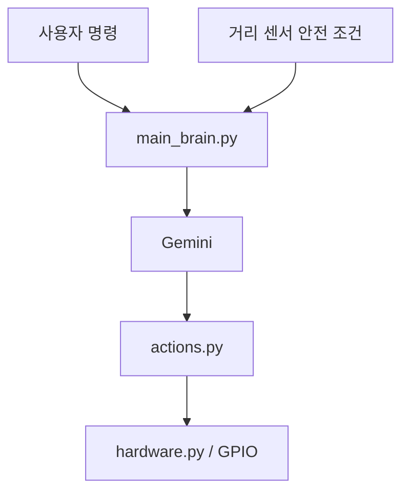

# robot

Raspberry Pi 기반 로봇이 사용자 명령과 거리 센서 정보를 바탕으로 Gemini function calling을 사용해 행동을 선택하는 Python 실험 프로젝트입니다.

## 프로젝트 목적

이 저장소는 라즈베리파이에 연결된 이동 로봇을 자연어로 제어하는 구조를 실험합니다. 사용자가 "앞으로 가", "멈춰", "돌아" 같은 명령을 내리면 Python 코드가 현재 전방 거리와 함께 Gemini 모델에 판단을 요청하고, 모델은 허용된 함수 목록 중 안전한 행동을 선택합니다.

현재 코드는 실제 GPIO 제어 전 단계의 prototype입니다. `actions.py`와 `hardware.py`는 가상 출력 중심이므로, Raspberry Pi 배선과 motor driver 연동은 `docs/` 문서를 기준으로 확장하면 됩니다.

## 기술 스택

- Python 3
- Raspberry Pi OS
- Google Gemini API
- `google-genai`
- `google-generativeai`
- `python-dotenv`
- gTTS
- pygame
- Raspberry Pi GPIO 확장 예정

## 아키텍처



`main_brain.py`는 최신 `google.genai` 클라이언트를 사용해 명령과 거리 정보를 모델에 전달하고, function call 결과를 `actions.py`의 행동 함수로 실행합니다. `2main_brain.py`는 이전 `google.generativeai` 기반 실험 파일입니다. 실제 모터/센서 제어는 `hardware.py`를 GPIO 구현으로 교체하는 방향이 가장 깔끔합니다.

## 폴더 구조

```text
.
├── main_brain.py
├── 2main_brain.py
├── actions.py
├── hardware.py
├── test_case.py
├── requirements.txt
├── .env.example
├── docs/
│   ├── architecture.md
│   ├── publication-checklist.md
│   ├── raspberry-pi-setup.md
│   └── wiring.md
└── README.md
```

## Raspberry Pi 준비

자세한 준비 과정은 [Raspberry Pi Setup](docs/raspberry-pi-setup.md)을 참고하세요.

요약:

```bash
sudo apt update
sudo apt install -y python3-venv python3-pip git portaudio19-dev
git clone https://github.com/cora1022/robot.git
cd robot
python3 -m venv .venv
source .venv/bin/activate
pip install -r requirements.txt
cp .env.example .env
```

`.env`에 실제 Google API key를 넣습니다. 실제 키는 절대 git에 커밋하지 마세요.

## 실행 방법

```bash
source .venv/bin/activate
python main_brain.py
```

Windows/PowerShell에서 로컬 테스트:

```powershell
python -m venv .venv
.\.venv\Scripts\Activate.ps1
pip install -r requirements.txt
Copy-Item .env.example .env
python main_brain.py
```

## 환경변수

`.env.example`:

```env
GOOGLE_API_KEY=your-google-api-key
GEMINI_MODEL=gemini-2.5-flash
```

## 시각 자료

- [아키텍처 다이어그램](docs/architecture.md)
- [라즈베리파이 배선 가이드](docs/wiring.md)
- [공개 전 체크리스트](docs/publication-checklist.md)

## 공개 전 보안 상태

현재 브랜치에서는 hardcoded Google API key를 제거하고 `GOOGLE_API_KEY` 환경변수로 이동했습니다. 하지만 과거 커밋에 실제 Google API key 형태 값이 있었기 때문에, 아래 작업 전에는 저장소를 public으로 전환하지 마세요.

1. 노출된 Google API key 폐기 및 재발급
2. 기본 브랜치 history에서 secret 제거
3. `docs/publication-checklist.md`의 current-file/history secret scan 통과

이 조건이 충족되면 공개 전환 후보입니다.
