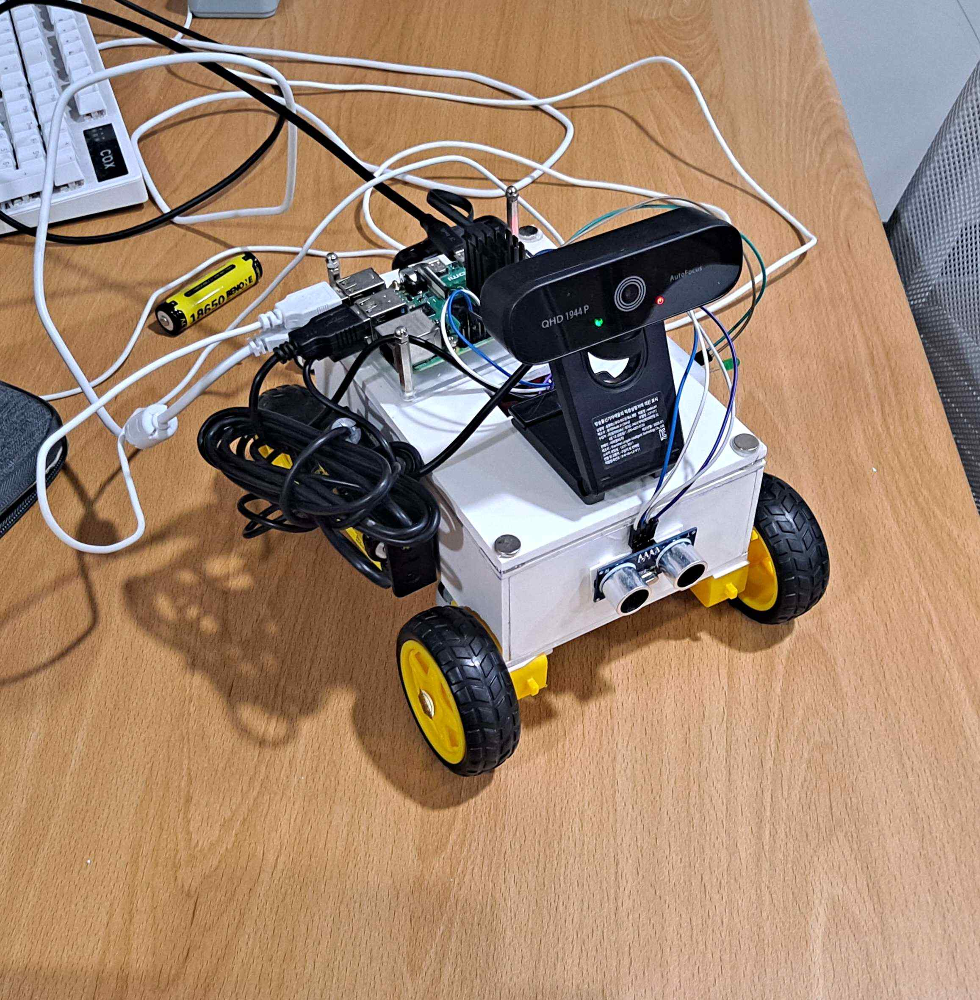
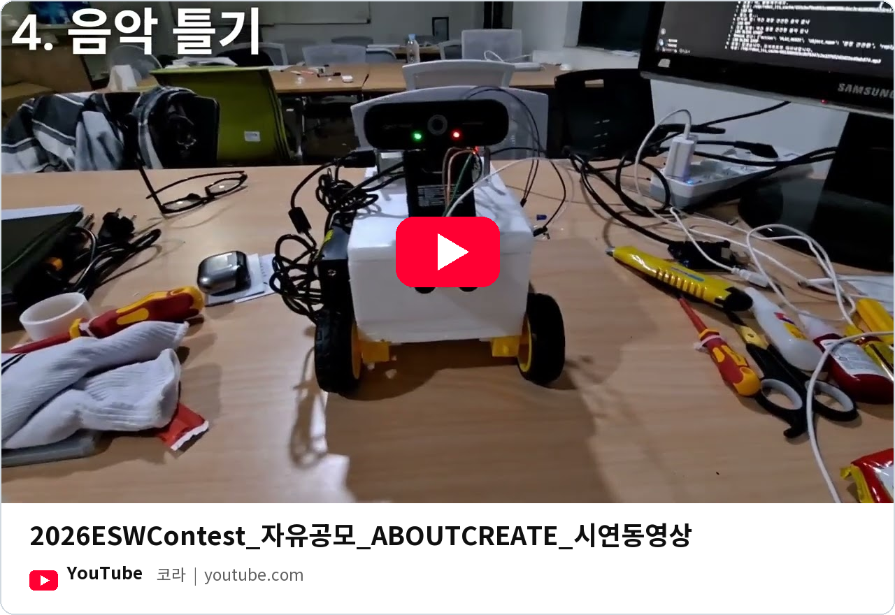
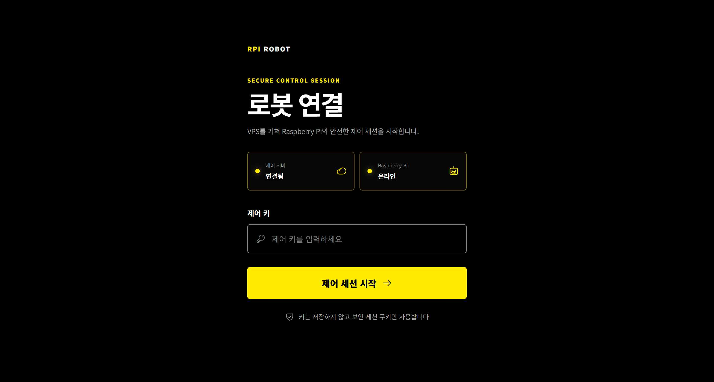
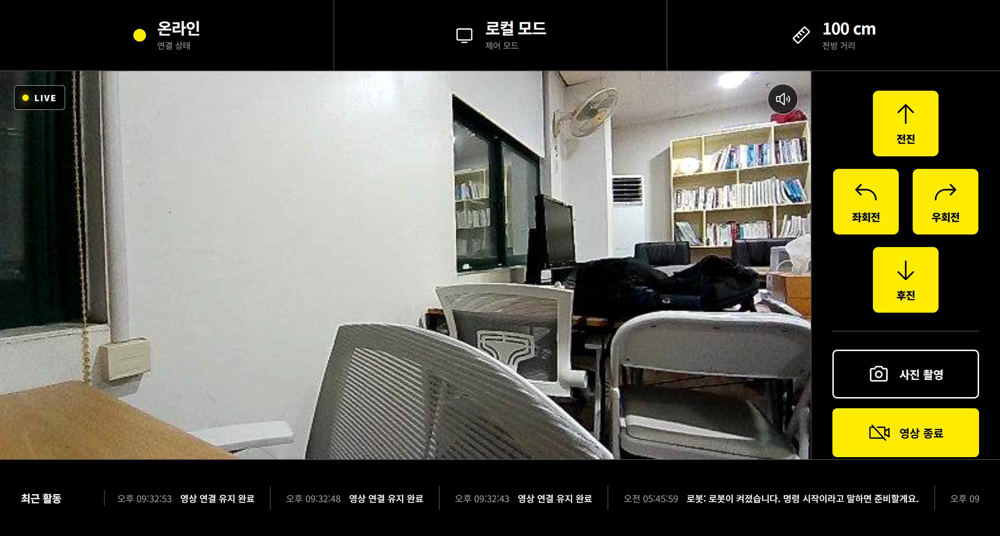
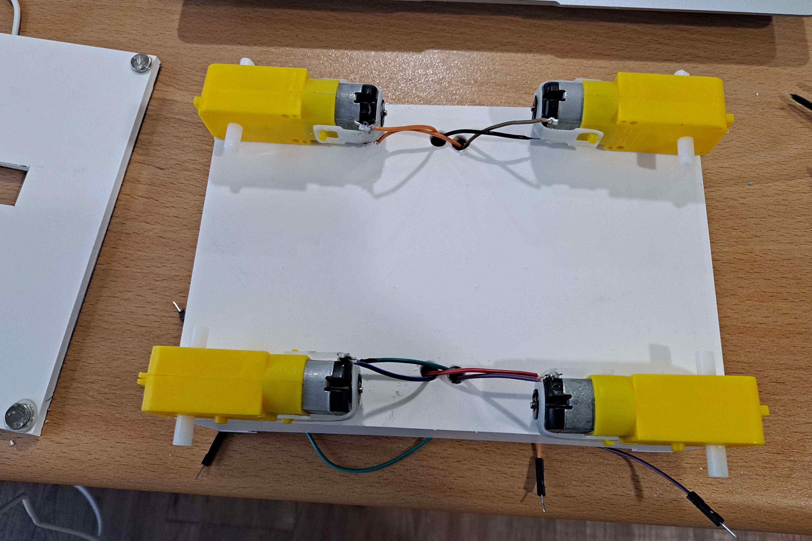
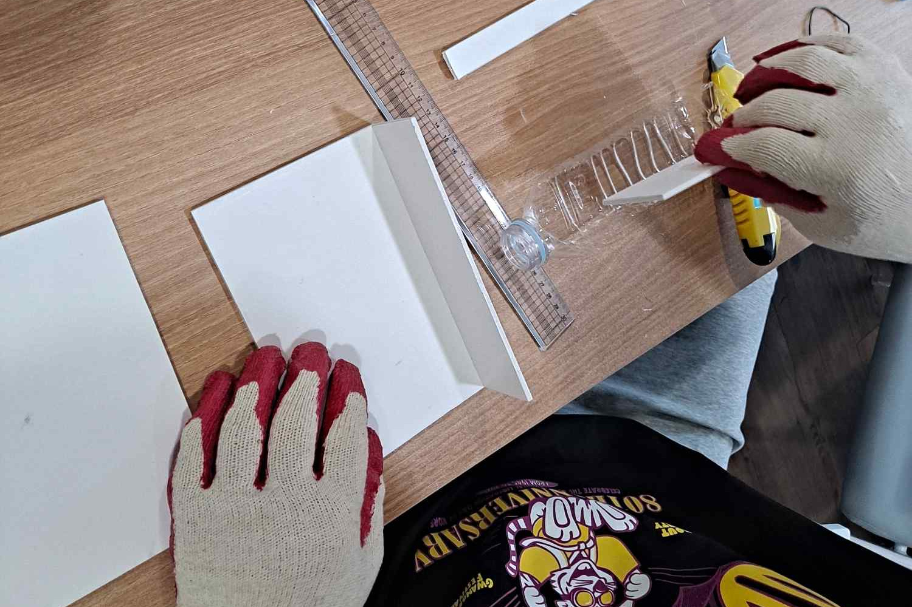
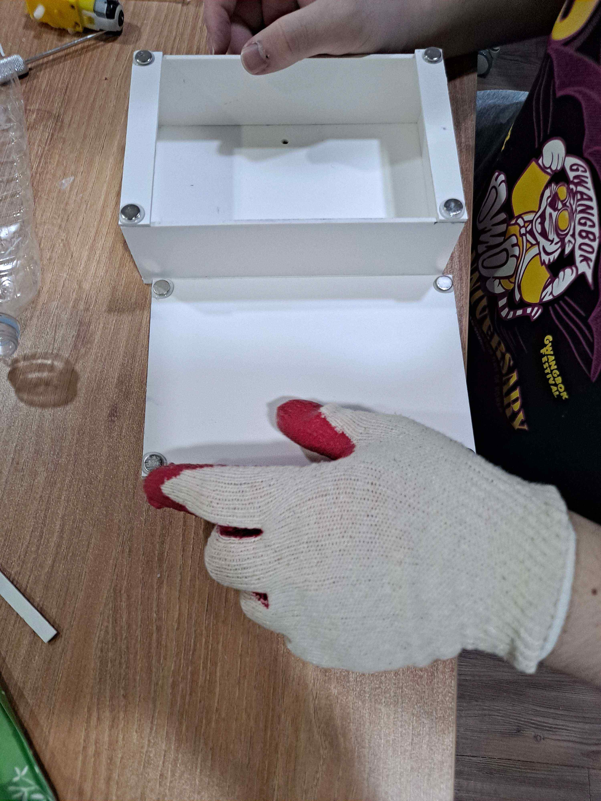
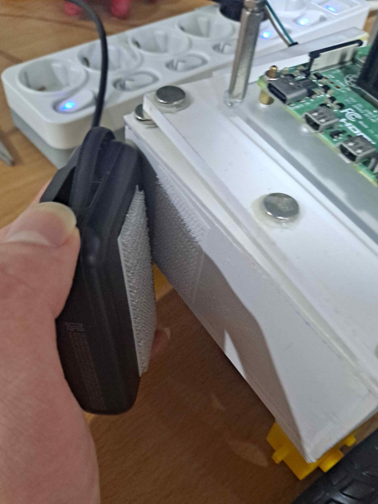
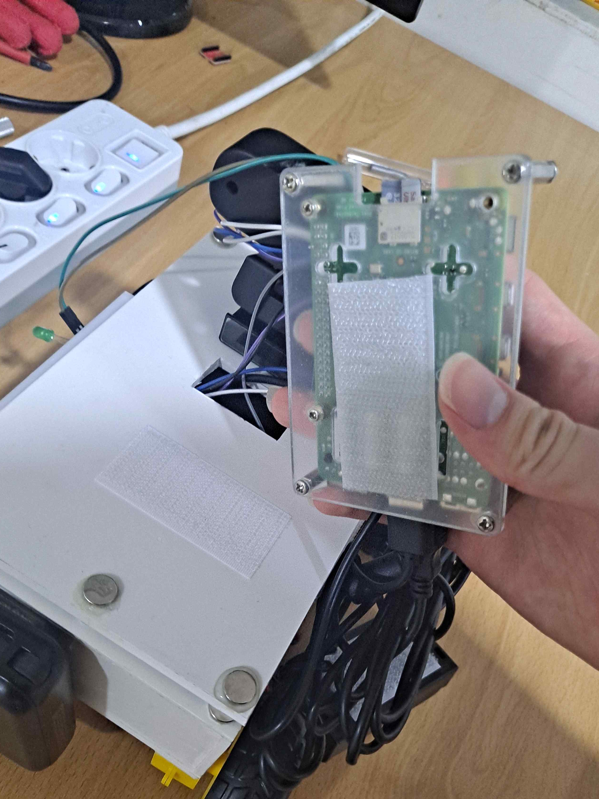
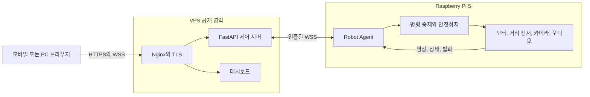

<p align="center">
  
</p>

# 생각하고 동작하는 라즈베리파이 로봇

> 제24회 임베디드SW경진대회 자유공모부문 개발작 | 팀 About Create

브라우저에서 Raspberry Pi 5 로봇을 원격으로 운전하고, 컬러 카메라 영상과 로봇의 발화를 실시간으로 확인하는 하드웨어 소프트웨어 통합 프로젝트입니다. VPS는 인증과 메시지 중계를 담당하고, 실제 주행 허용 여부와 안전정지는 Raspberry Pi가 최종 결정합니다.

IoT 수업의 과제 대체 프로젝트로 시작했습니다. OpenClaw가 상황에 맞는 도구를 골라 컴퓨터를 조작하는 방식에서 아이디어를 얻어, 자연어 명령을 실제 공간의 동작으로 연결하려고 했습니다. 처음에는 한국어 음성 명령을 Gemini로 해석하고, 카메라와 거리 센서로 주변을 확인한 뒤 움직이는 실물 로봇을 만들었습니다. 이후 브라우저 대시보드와 VPS 중계 서버를 추가하고, 로봇과 서버가 통신 규격을 공유하는 모노레포로 확장했습니다.

[실물 시연](#실물-시연) | [원격 제어 화면](#원격-제어-화면) | [제작 과정](#제작-과정) | [설치와 실행](#설치와-실행)

## 실물 시연

<p align="center">
  
</p>

음성 명령, 카메라 판단과 모터 동작을 연결했던 초기 프로토타입 시연입니다. 현재 모노레포의 브라우저 원격 주행을 검증한 영상은 아닙니다.

<p align="center">
  <a href="https://youtu.be/NtMfFOqJAB8"></a>
</p>

## 프로젝트 목표

네트워크가 불안정한 원격 환경에서도 로봇이 마지막 명령을 계속 실행하지 않도록 만드는 것이 핵심 목표였습니다. 이를 위해 주행 명령에 짧은 유효시간을 부여하고, 연결 단절이나 센서 실패를 Raspberry Pi에서 직접 감지해 모터를 정지하도록 설계했습니다.

## 주요 기능

| 기능 | 동작 |
|---|---|
| 한국어 음성 명령 | 음성을 텍스트로 바꾸고 Gemini가 허용된 행동 단계로 해석 |
| 단계별 행동 실행 | 행동명과 반복 횟수를 확인한 뒤 모터, 센서, 카메라와 음성 출력으로 연결 |
| 웹 원격 제어 | 모바일과 PC 브라우저에서 방향 명령을 전달하고 로봇 상태 확인 |
| 영상과 발화 전달 | 카메라 영상, 로봇의 음성 안내와 실행 결과를 웹 화면으로 전달 |
| 로봇 내부 안전정지 | 연결 종료, 센서 실패와 원격 주행 유효시간 만료를 Raspberry Pi에서 처리 |
| 대체 명령 처리 | Gemini 호출이 실패하면 규칙 기반 분류기로 단순 명령 처리 |

## 원격 제어 화면

개발완료보고서에 수록된 웹 화면입니다. 세션 연결 화면에서는 VPS와 로봇의 연결 상태를 확인하고 제어 키로 접속합니다.

<p align="center">
  
</p>

제어 화면에는 카메라 영상, 로봇 연결 상태, 제어 모드와 전방 거리가 표시됩니다. 방향 버튼과 사진 촬영, 영상 종료 기능을 제공하며 하단에서 최근 실행 기록을 확인할 수 있습니다.

<p align="center">
  
</p>

보고서는 PC와 모바일을 통한 원격 제어를 개발 결과로 설명합니다. 현재 저장소에 남은 자동 테스트와 실제 하드웨어 인수 시험의 범위는 [자동 검증](#자동-검증)에서 따로 정리했습니다.

## 제작 과정

Raspberry Pi와 모터 드라이버를 차체에 배치하고, 모터 전원과 제어 배선을 연결한 뒤 카메라, 초음파 센서와 오디오 장치를 통합했습니다. 아래 사진은 초기 실물 제작 당시의 기록입니다.

<p align="center">
  
  &nbsp;
  
  &nbsp;
  
</p>

배터리 전압, USB 장치 번호, 바닥 마찰과 센서 방향에 따라 실물 동작이 달라졌습니다. 배선, 모터, 거리 측정, 카메라와 음성을 각각 확인한 뒤 전체 흐름으로 연결했습니다.

### 차체와 구동부

초기에는 스티로폼과 양면테이프로 차체를 조립했지만 내구성이 약했습니다. 이후 포맥스 판과 전용 접착제로 케이스를 다시 제작했습니다. 차체 하부에는 TT 모터를 배치하고 L298N으로 구동합니다.

<p align="center">
  
  &nbsp;&nbsp;
  
</p>

### 분리해서 수리할 수 있는 구조

부품을 본체에 고정한 초기 구조에서는 특정 부품만 분리해 수리하기 어려웠습니다. 지붕에는 자석을 사용하고 배터리와 Raspberry Pi는 벨크로로 고정해, 배선과 부품을 점검할 때 분리할 수 있도록 바꿨습니다.

<p align="center">
  
  &nbsp;
  
  &nbsp;
  
</p>

과거 제작 사진과 GIF는 Git 기록의 [`25dc0ae`](https://github.com/cora1022/2026ESWContest_free_ABOUTCREATE/tree/25dc0ae/docs/images)에서 복원했습니다. 당시의 제작 과정과 공개 코드 복원 경위는 [과거 프로젝트 기록](https://github.com/cora1022/2026ESWContest_free_ABOUTCREATE/blob/25dc0ae/docs/ko/project-story.md)에 남아 있습니다.

## 시스템 구성



| 실행 환경 | 책임 |
|---|---|
| 브라우저 | 로그인, 방향 입력, 컬러 영상, 상태와 발화 표시 |
| VPS | 세션 인증, 명령 중계, 상태 팬아웃, 최신 프레임 전달 |
| Raspberry Pi | 음성 명령, 모터 제어, 거리 판단, 카메라와 오디오 처리, 안전정지 |
| `robot-protocol` | 양쪽이 공유하는 명령, 메시지와 바이너리 프레임 계약 |

## 핵심 설계

- 안전 판단을 VPS가 아닌 Raspberry Pi에 둬 서버 연결이 끊겨도 정지할 수 있습니다.
- 원격 주행은 짧은 주행 허용시간인 lease를 반복 갱신하며, 갱신이 끊기면 자동으로 모터를 정지합니다.
- 영상과 텔레메트리는 오래된 항목을 버리고 최신 값만 남겨 지연 누적을 줄입니다.
- 명령 결과와 상태 이벤트는 영상보다 우선 전송하고, 송신 제한시간을 넘기면 연결을 재수립합니다.
- 카메라는 JPEG 바이트를 전용 바이너리 프레임으로 전송해 Base64 영상 변환 비용을 피합니다.
- 로봇 토큰과 대시보드 키를 분리하고, 브라우저 인증 후에는 HttpOnly 세션 쿠키를 사용합니다.

상세한 판단 근거는 [아키텍처](docs/architecture.md)와 [ADR](docs/adr/)에서 확인할 수 있습니다.

## 저장소 구조

```text
robot-pj/
├─ packages/robot-protocol/   공통 메시지와 바이너리 전송 규격
├─ robot/                     Raspberry Pi 애플리케이션과 하드웨어 어댑터
├─ server/                    VPS API 서버와 웹 대시보드
└─ docs/                      설계, 배포, 테스트와 하드웨어 문서
```

로봇과 서버는 각자 독립된 가상환경으로 배포하지만, 같은 저장소의 `robot-protocol` 패키지를 설치합니다. 이 방식은 공통 규격의 복사본이 서로 달라지는 문제를 막으면서 두 실행 환경을 독립적으로 운영할 수 있게 합니다.

## 기술 구성

- Raspberry Pi 5, Python 3.11 이상, systemd
- L298N 모터 드라이버, HC-SR04, USB UVC 카메라, ALSA 오디오
- FastAPI, Uvicorn, WebSocket, Nginx, TLS
- OpenCV, SpeechRecognition, Google Gemini 선택 연동
- HTML, CSS, JavaScript 기반 반응형 대시보드
- Python `unittest`와 `pytest`, FastAPI TestClient, 하드웨어 테스트 더블

## 설치와 실행

로봇과 VPS는 각각 별도 가상환경을 사용합니다. 아래 명령은 저장소 루트에서 시작하며, Raspberry Pi의 OS 패키지와 장치 설정은 [Raspberry Pi 배포 문서](docs/deployment/raspberry-pi.md)를 먼저 확인합니다.

### Raspberry Pi

```bash
git clone https://github.com/cora1022/2026ESWContest_free_ABOUTCREATE.git robot-pj
cd robot-pj
python3 -m venv robot/.venv
robot/.venv/bin/python -m pip install ./packages/robot-protocol ./robot
cp robot/.env.example robot/.env
```

`robot/.env`에 VPS 주소와 로봇 토큰, 사용할 API 키를 설정한 뒤 실행합니다.

```bash
cd robot
.venv/bin/robot-agent
```

실행 시 GPIO와 장치를 초기화하므로 최초 시험은 바퀴를 띄운 상태에서 진행합니다. 전원 구성, HC-SR04의 3.3V 레벨 변환과 모터 시험 순서는 [하드웨어 문서](docs/hardware.md)에 정리했습니다.

### VPS 서버

같은 저장소를 VPS에 준비한 뒤 루트에서 설치합니다.

```bash
python3 -m venv server/.venv
server/.venv/bin/python -m pip install ./packages/robot-protocol ./server
```

`server/.env.example`을 기준으로 `ROBOT_TOKEN`, `DASHBOARD_KEY` 등 환경변수를 설정한 뒤 실행합니다.

```bash
cd server
.venv/bin/uvicorn server.app:app --host 127.0.0.1 --port 8000 --workers 1
```

서버는 단일 worker로 실행합니다. 외부 공개를 위한 Nginx, TLS와 systemd 설정은 [VPS 배포 문서](docs/deployment/vps.md)를 확인합니다.

## 자동 검증

GitHub Actions에서 공통 프로토콜, 로봇 애플리케이션과 VPS 서버를 각각 설치하고 테스트합니다. [2026년 9월 2일 검증 기록](docs/testing.md) 기준 자동 테스트는 총 66개이며, 서버 wheel에 웹 정적 파일이 포함되는지도 별도로 확인합니다.

| 대상 | 테스트 |
|---|---:|
| `robot-protocol` | 22개 |
| Raspberry Pi 애플리케이션 | 24개 |
| VPS 서버 | 20개 |

JavaScript 모듈은 Node 구문 검사를 거친 뒤 브라우저 통합 검증을 수행합니다. 실제 모터와 센서 시험은 자동 테스트와 구분해 하드웨어 안전 절차에 따라 진행합니다.

운영 기록에서는 USB 카메라 촬영, 마이크 녹음, 스피커 재생과 VPS의 로봇 온라인 상태를 확인했습니다. HC-SR04 반복 측정, 교정된 네 방향 모터 동작과 브라우저 원격 주행은 추가 물리 검증이 필요합니다.

## 개발 일정과 역할

보고서의 개발 일정은 5월, 6월과 8월로 나뉩니다. 5월과 6월에는 기획, 로봇 본체 제작과 LLM 연동을 진행했고, 8월에는 케이스 개선, AI 기능 보완과 웹 원격 서버 구축을 거쳐 로봇과 서버를 연동했습니다.

| 팀원 | 담당 역할 |
|---|---|
| 황영연, 팀장 | Raspberry Pi의 LLM 연동, 소프트웨어 개발과 조율, 로봇 제작 보조, 서버 백엔드 개발 |
| 김민준, 팀원 | Raspberry Pi와 모터 드라이버 연결, 케이스 조립, 완성 코드 디버깅과 소프트웨어 개발 보조 |

## 문서

- [개발완료보고서 반영 내용과 이미지 출처](docs/development-report.md)
- [전체 아키텍처](docs/architecture.md)
- [공통 통신 프로토콜](docs/protocol.md)
- [Raspberry Pi 배포](docs/deployment/raspberry-pi.md)
- [VPS 배포](docs/deployment/vps.md)
- [테스트 전략과 검증 범위](docs/testing.md)
- [하드웨어 구성과 안전 조건](docs/hardware.md)
- [설계 결정 기록](docs/adr/)
