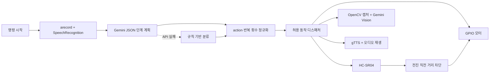
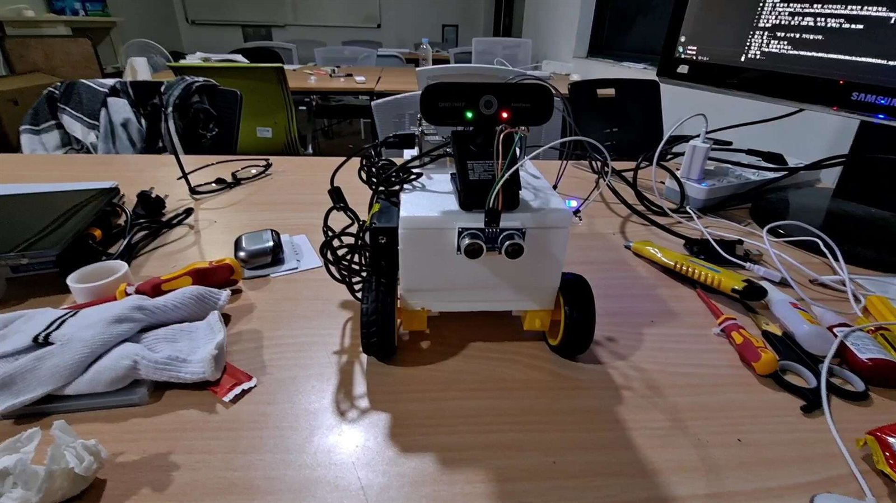

[English](README.en.md) | [한국어](README.md)

# Gemini Raspberry Pi Robot

> 음성 명령을 이해하고, 주변을 확인하고, 허용된 물리 동작을 실행하는 Raspberry Pi 5 로봇.

[만들게 된 이야기](docs/ko/project-story.md) · [아키텍처](docs/ko/architecture.md) · [설치와 실행](docs/ko/raspberry-pi-setup.md) · [배선](docs/ko/wiring.md) · [공개 전 점검](docs/ko/publication-checklist.md)

<p align="center">
  
</p>

## 프로젝트 소개

IoT 사물인터넷 수업의 과제 대체 프로젝트로 제작한 개인 프로젝트입니다. 시각장애인용 지팡이, 음주 측정기, 사람 감지 웹 등 여러 주제를 검토하다가 Raspberry Pi와 LLM API를 결합해 **스스로 상황을 확인하고 판단한 뒤 움직이는 로봇**을 만들기로 했습니다.

사용자가 “명령 시작”이라고 말하면 로봇이 한국어 음성을 녹음·인식합니다. Gemini는 명령을 제한된 단계 목록으로 분류하고, 애플리케이션은 그 결과를 검증한 뒤 모터·초음파 센서·카메라·스피커 기능으로 연결합니다. 카메라 질문과 물체 접근에는 Gemini Vision을 사용합니다.

## 소스 복원 기록

2026년 7월 9일 공개 저장소를 새 Git 기록으로 정리할 때 5월 28일 발표용 최종 통합 파일 대신 초기 function calling 실험 파일이 올라갔습니다. 영상에는 실물 동작이 보이지만 당시 공개 코드는 출력용 스텁만 포함해 둘 사이에 차이가 있었습니다.

2026년 8월 9일 로컬 백업 `robot_pj_long_listen`을 확인해 발표에 사용한 `main_brain.py`, `actions.py`, `hardware.py`를 복원했습니다. 복원 과정에서 폐기된 API 키가 남은 과거 백업은 사용하지 않았고, 현재 저장소는 키를 `.env` 또는 환경변수로만 읽습니다. 자세한 과정은 [프로젝트 스토리](docs/ko/project-story.md)에 기록했습니다.

## 구현 기능

| 영역 | 현재 공개 코드 |
| --- | --- |
| 음성 명령 | `arecord`로 녹음하고 Google Speech Recognition으로 한국어 변환 |
| 명령 계획 | Gemini가 허용된 action으로 구성된 JSON `steps` 배열 생성 |
| 대체 판단 | Gemini 호출 실패 시 규칙 기반 명령 분류기 사용 |
| 연속 동작 | 전진·후진·좌우 회전·180도 회전·정지를 순서와 반복 횟수대로 실행 |
| 거리 측정 | HC-SR04를 세 번 읽고 중앙값 사용 |
| 전진 차단 | 전진 직전에 거리를 읽어 기본 25cm 이내면 코드에서 취소 |
| 장애물 전진 | 센서를 반복 확인하며 기본 18cm 앞에서 정지 |
| 카메라 | OpenCV로 USB 카메라 프레임을 JPEG로 캡처 |
| 시각 판단 | Gemini Vision으로 사물 존재, 위치, 조건 충족 여부 판단 |
| 물체 접근 | 목표를 찾고 좌·우 정렬과 짧은 전진을 반복, 최대 7단계 후 정지 |
| 음성 출력 | gTTS로 생성한 음성을 `mpg123` 또는 `ffplay`로 재생 |
| 상태 LED | 대기·명령 수신·처리 상태를 GPIO25 LED로 표시 |

## 실행 흐름



Gemini가 GPIO를 직접 조작하지는 않습니다. 모델은 허용된 action 이름과 반복 횟수를 제안하고, `RobotActions`가 이를 정규화한 뒤 `RobotHardware`의 메서드만 호출합니다. 전진 시 거리 조건은 프롬프트가 아니라 `hardware.py`의 조건문에서도 검사합니다.

자세한 호출 순서는 [아키텍처 문서](docs/ko/architecture.md)를 참고하세요.

## 데모 영상

| 영상 | 확인할 수 있는 동작 |
| --- | --- |
| <a href="https://youtu.be/QIJOv5Q-LHc"></a> | **장애물 접근**<br>초음파 거리 확인과 전진 정지 |
| <a href="https://youtu.be/0o1b3L9IwOY"></a> | **사물 확인 후 이동**<br>카메라, Gemini Vision과 모터 동작 결합 |
| <a href="https://youtu.be/ix_nwpkvWfA"></a> | **오디오 재생**<br>TTS와 스피커 출력 |
| <a href="https://youtube.com/shorts/KLmq6Mq9xEY?feature=share"></a> | **앞뒤 반복 이동**<br>여러 단계와 반복 횟수 실행 |
| <a href="https://youtube.com/shorts/O0WwkEZf5KQ?feature=share"></a> | **이동 후 시각 판단**<br>현재 위치에서 새 프레임을 캡처해 답변 |

## 하드웨어

- Raspberry Pi 5
- L298N 모터 드라이버
- 2륜 DC 모터 차체와 별도 모터 전원
- HC-SR04 초음파 센서
- USB 카메라
- USB 마이크와 스피커
- 명령 상태 LED

코드에서 사용하는 BCM GPIO는 다음과 같습니다.

| 장치 | BCM GPIO |
| --- | --- |
| L298N IN1 / IN2 | 5 / 6 |
| L298N IN3 / IN4 | 16 / 26 |
| HC-SR04 TRIG / ECHO | 23 / 24 |
| 상태 LED | 25 |

HC-SR04 ECHO는 일반적으로 5V 신호를 출력할 수 있으므로 Raspberry Pi GPIO24에 직접 연결하지 말고 저항 분압기 또는 레벨 시프터를 사용해야 합니다. 전체 배선과 최초 테스트 순서는 [배선 문서](docs/ko/wiring.md)를 확인하세요.

## 빠른 시작

### 1. 설치

```bash
git clone https://github.com/cora1022/gemini-raspberry-pi-robot.git
cd gemini-raspberry-pi-robot
python3 -m venv .venv
source .venv/bin/activate
python -m pip install --upgrade pip
pip install -r requirements.txt
cp .env.example .env
```

Raspberry Pi OS 시스템 패키지와 장치 확인 절차는 [설치 문서](docs/ko/raspberry-pi-setup.md)에 정리했습니다.

### 2. 환경변수

`.env`에서 최소한 다음 값을 설정합니다.

```text
GOOGLE_API_KEY=your-google-api-key
GEMINI_MODEL=gemini-2.5-flash
```

카메라 번호, USB 오디오 장치, 이동 시간과 안전거리는 `.env.example`의 항목으로 조절할 수 있습니다. 실제 API 키가 들어 있는 `.env`는 Git에 추가하지 않습니다.

### 3. 하드웨어 없이 명령 계획 확인

```bash
python test_case.py
```

이 파일은 모터·센서·카메라·마이크를 초기화하지 않고 명령 계획만 확인합니다. API 키가 없으면 규칙 기반 대체 분류기가 동작합니다.

### 4. 실물 로봇 실행

```bash
python main_brain.py
```

`main_brain.py`는 실행 즉시 GPIO와 카메라를 초기화하고 음성 대기 루프를 시작합니다. 최초 실행은 바퀴를 바닥에서 띄우고 별도 전원 차단 수단을 준비한 상태에서 진행하세요.

## 파일 역할

| 파일 | 역할 |
| --- | --- |
| `main_brain.py` | 웨이크워드, 음성 명령 재시도와 전체 실행 루프 |
| `actions.py` | Gemini 계획, 규칙 기반 대체 분류, 단계 실행, Vision과 물체 접근 |
| `hardware.py` | GPIO 모터, HC-SR04, LED, USB 카메라, 녹음, STT, TTS |
| `test_case.py` | 하드웨어 없이 명령 계획을 확인하는 시나리오 |
| `2main_brain.py` | 이전 function calling 실험. 현재 실행 경로가 아닌 레거시 참고 파일 |
| `.env.example` | 동작 시간, 거리, 카메라와 오디오 설정 예시 |

## 안전과 현재 제한사항

- 전진 직전 거리 차단과 연속 전진 중 센서 확인이 구현돼 있지만 물리 긴급 정지 장치는 별도로 준비해야 합니다.
- HC-SR04가 반사파를 받지 못한 timeout은 앞이 비어 있다고 보고 기본 400cm로 처리합니다. 센서 단선과 넓은 공간을 완전히 구분하지는 못합니다.
- 회전과 후진에는 후방·측면 센서가 없으므로 주변 공간을 확보해야 합니다.
- Gemini Vision과 음성 인식, gTTS는 네트워크 상태에 따라 지연될 수 있습니다.
- 규칙 기반 대체 분류기는 단순 명령의 최소 동작을 위한 경로이며, 여러 행동이 섞인 복합 문장을 Gemini와 같은 수준으로 해석하지 못합니다.
- 카메라 번호와 USB 오디오 장치명은 Raspberry Pi 연결 순서에 따라 달라질 수 있습니다.
- 음악 재생 기능은 로컬 `music/` 폴더의 파일을 사용하며 저작권 문제로 음원은 저장소에 포함하지 않습니다.
- 자동 하드웨어 테스트와 물리 긴급 정지 입력은 아직 없습니다.
- `2main_brain.py`는 기록 보존용이며 현재 런타임과 호환되지 않습니다.

## 상세 문서

- [만들게 된 이야기와 공개 코드 복원](docs/ko/project-story.md)
- [현재 아키텍처](docs/ko/architecture.md)
- [Raspberry Pi 설치와 실행](docs/ko/raspberry-pi-setup.md)
- [배선과 최초 테스트](docs/ko/wiring.md)
- [공개 전 점검표](docs/ko/publication-checklist.md)

## 제작 사진

| 제어부 | 차체 | 배선 |
| --- | --- | --- |
|  |  |  |

<p align="center">
  
</p>
