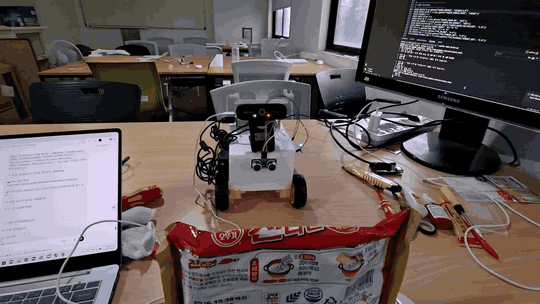
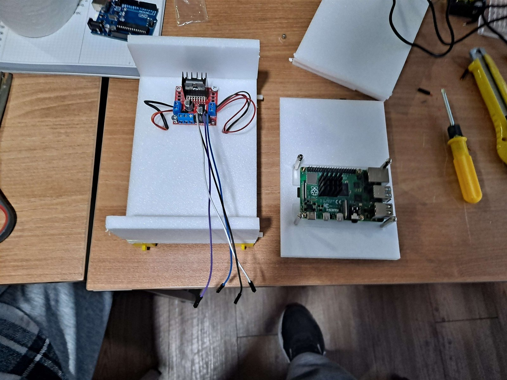
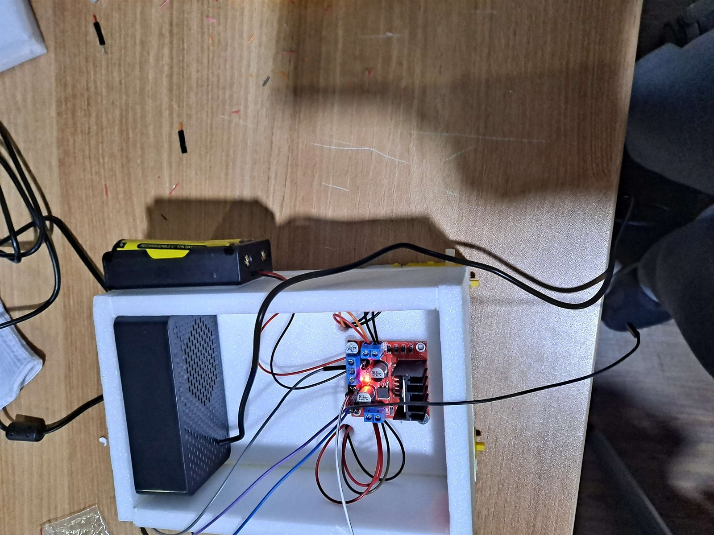
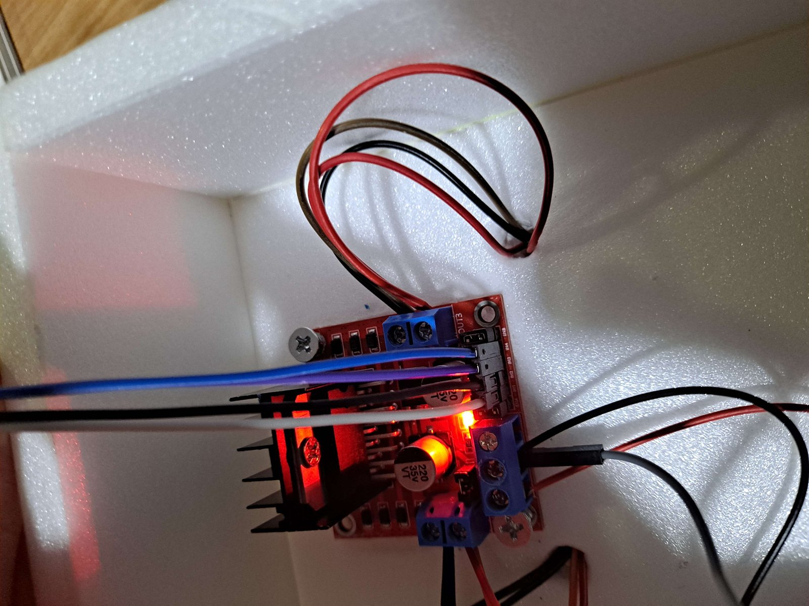
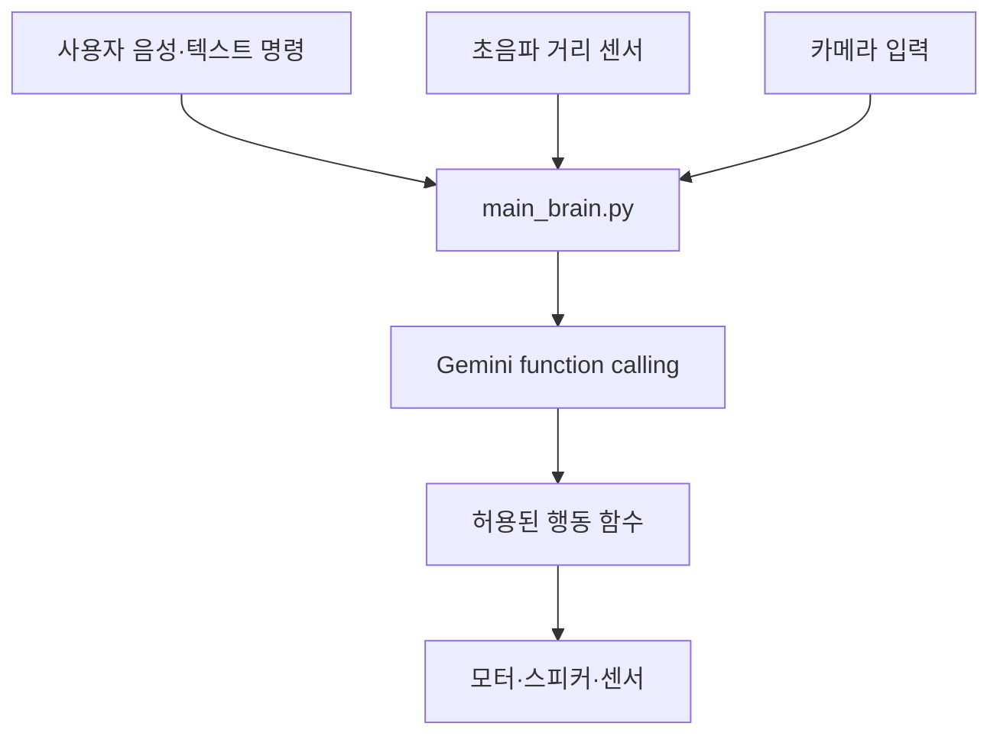

# Raspberry Pi AI Robot

<p align="center">
  
</p>

Raspberry Pi 기반 이동 로봇에 Gemini function calling을 연결해 자연어 명령을 실제 행동으로 변환하는 프로젝트입니다. 거리 센서와 카메라로 주변 상황을 확인하고, 허용된 행동 함수 안에서 이동·정지·회전·음성 응답을 수행하는 흐름을 실험했습니다.

## 핵심 기능

- 자연어 명령과 현재 센서 정보를 Gemini에 함께 전달합니다.
- Gemini가 미리 허용된 Python 함수 중 필요한 행동을 선택합니다.
- 전방 20cm 이내에 장애물이 있으면 전진하지 않는 안전 조건을 둡니다.
- gTTS와 pygame을 이용해 한국어 음성 응답을 재생합니다.
- 카메라로 사물을 확인한 뒤 이동하거나, 이동 후 이미지를 다시 판단하는 복합 명령을 실험했습니다.
- 연속 이동과 반복 명령처럼 여러 단계로 구성된 행동을 시연했습니다.

## 주요 시연

아래 이미지를 누르면 YouTube에서 실제 로봇 시연을 확인할 수 있습니다.

| 시연 | 확인한 기능 |
| --- | --- |
| <a href="https://youtu.be/QIJOv5Q-LHc"></a> | **충돌 직전까지 앞으로 이동**<br>전방 상황을 고려해 장애물 가까이까지 접근하는 동작 |
| <a href="https://youtu.be/0o1b3L9IwOY"></a> | **사물을 인식하고 뒤로 이동**<br>카메라 조건과 이동 명령을 결합한 시연 |
| <a href="https://youtu.be/ix_nwpkvWfA"></a> | **노래 기능**<br>스피커를 이용한 음성·오디오 출력 |
| <a href="https://youtube.com/shorts/KLmq6Mq9xEY?feature=share"></a> | **앞으로·뒤로 반복 이동**<br>연속 동작과 반복 명령 처리 |
| <a href="https://youtube.com/shorts/O0WwkEZf5KQ?feature=share"></a> | **이동 후 이미지 판단**<br>물리적 행동 뒤 카메라 입력을 다시 확인하는 복합 흐름 |

## 제작 과정

| 1. 제어부 준비 | 2. 몸체 조립 | 3. 배선 연결 |
| --- | --- | --- |
|  |  |  |

## 시스템 흐름



1. 사용자 명령과 현재 센서 정보를 수집합니다.
2. `main_brain.py`가 명령과 상황을 Gemini에 전달합니다.
3. Gemini는 등록된 함수 목록 안에서 행동을 선택합니다.
4. `actions.py`와 하드웨어 경계가 선택된 행동을 실행합니다.
5. 이동 결과나 새 카메라 입력이 필요하면 다음 판단으로 이어집니다.

모델이 임의의 코드를 직접 실행하지 않고 제한된 함수만 선택하도록 구성한 것이 핵심입니다.

## 하드웨어 구성

- Raspberry Pi 5
- L298N 모터 드라이버
- 2륜 DC 모터 차체와 별도 모터 전원
- HC-SR04 초음파 거리 센서
- USB 카메라
- 마이크와 스피커 또는 USB 오디오 장치

구체적인 GPIO 예시와 전원 주의사항은 [배선 가이드](docs/wiring.md)에 정리했습니다.

## 주요 파일

| 파일 | 역할 |
| --- | --- |
| `main_brain.py` | 명령과 거리 정보를 Gemini에 전달하고 function call 결과를 실행합니다. |
| `actions.py` | 모델에 노출할 이동·정지·회전·음성 응답 함수의 인터페이스입니다. |
| `hardware.py` | 실제 GPIO 제어와 로컬 테스트를 분리하기 위한 하드웨어 경계입니다. |
| `2main_brain.py` | 이전 `google-generativeai` SDK로 진행한 실험 코드입니다. |
| `test_case.py` | 센서 값과 명령을 가정해 판단 흐름을 확인하는 테스트 파일입니다. |
| `docs/` | 아키텍처, Raspberry Pi 설정, 배선, 공개 체크리스트를 보관합니다. |

## 공개 코드 범위

현재 저장소의 `main_brain.py`와 `actions.py`는 Gemini function calling과 행동 선택 흐름을 재현하기 위한 공개용 코드입니다. 실제 로봇의 GPIO 번호, 카메라 처리, 오디오 장치 설정은 사용 환경에 따라 달라질 수 있으므로 하드웨어 경계와 문서를 기준으로 연결해야 합니다.

## 기술 스택

- Python 3
- Raspberry Pi
- Google Gemini API
- `google-genai`, `google-generativeai`
- `python-dotenv`
- gTTS, pygame

## 실행 준비

```bash
python3 -m venv .venv
source .venv/bin/activate
pip install -r requirements.txt
cp .env.example .env
```

`.env` 파일에 Google API 키를 넣습니다.

```text
GOOGLE_API_KEY=your-google-api-key
GEMINI_MODEL=gemini-2.5-flash
```

실제 API 키는 `.env`에만 보관하고 Git에 커밋하지 않습니다.

## 실행과 테스트

```bash
python main_brain.py
```

가상 명령과 거리 값으로 기본 판단 흐름을 확인하려면 다음 테스트 파일을 실행합니다.

```bash
python test_case.py
```

## 안전 주의사항

- 모터는 Raspberry Pi 5V 핀에서 직접 전원을 공급하지 않습니다.
- Raspberry Pi와 모터 드라이버는 공통 접지를 사용합니다.
- HC-SR04 ECHO 신호는 전압 분배기나 레벨 시프터를 거쳐 GPIO에 연결합니다.
- 최초 이동 테스트는 바퀴를 바닥에서 띄운 상태로 진행합니다.
- 실제 주행 전에는 정지 함수와 물리 전원 차단 방법을 먼저 확인합니다.

## 문서

- [아키텍처](docs/architecture.md)
- [Raspberry Pi 설정](docs/raspberry-pi-setup.md)
- [배선 가이드](docs/wiring.md)
- [공개 전 체크리스트](docs/publication-checklist.md)
