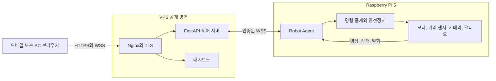

# Raspberry Pi 원격 제어 로봇

브라우저에서 Raspberry Pi 5 로봇을 원격으로 운전하고, 컬러 카메라 영상과 로봇의 발화를 실시간으로 확인하는 하드웨어 소프트웨어 통합 프로젝트입니다. VPS는 인증과 메시지 중계를 담당하고, 실제 주행 허용 여부와 안전정지는 Raspberry Pi가 최종 결정합니다.

## 프로젝트 목표

네트워크가 불안정한 원격 환경에서도 로봇이 마지막 명령을 계속 실행하지 않도록 만드는 것이 핵심 목표였습니다. 이를 위해 주행 명령에 짧은 유효시간을 부여하고, 연결 단절이나 센서 실패를 Raspberry Pi에서 직접 감지해 모터를 정지하도록 설계했습니다.

## 시스템 구성



| 실행 환경 | 책임 |
|---|---|
| 브라우저 | 로그인, 방향 입력, 컬러 영상, 상태와 발화 표시 |
| VPS | 세션 인증, 명령 중계, 상태 팬아웃, 최신 프레임 전달 |
| Raspberry Pi | 음성 명령, 모터 제어, 거리 판단, 카메라와 오디오 처리 |
| `robot-protocol` | 양쪽이 공유하는 명령, 메시지와 바이너리 프레임 계약 |

## 핵심 설계

- 안전 판단을 VPS가 아닌 Raspberry Pi에 둬 서버 연결이 끊겨도 정지할 수 있습니다.
- 원격 주행은 짧은 lease를 반복 갱신하며, 갱신이 끊기면 자동으로 모터를 정지합니다.
- 영상과 텔레메트리는 오래된 항목을 버리고 최신 값만 남겨 지연 누적을 줄입니다.
- 명령 결과와 상태 이벤트는 영상보다 우선 전송하고, 송신 제한시간을 넘기면 연결을 재수립합니다.
- 카메라는 JPEG 바이트를 전용 바이너리 프레임으로 전송해 Base64 영상 변환 비용을 피합니다.
- 로봇 토큰과 대시보드 키를 분리하고, 브라우저 인증 후에는 HttpOnly 세션 쿠키를 사용합니다.

상세한 판단 근거는 [아키텍처](docs/architecture.md)와 [ADR](docs/adr/)에서 확인할 수 있습니다.

## 저장소 구조

```text
robot-pj/
├─ packages/robot-protocol/   공통 메시지와 바이너리 전송 규격
├─ robot/                     Raspberry Pi 애플리케이션과 하드웨어 어댑터
├─ server/                    VPS API 서버와 웹 대시보드
└─ docs/                      설계, 배포, 테스트와 하드웨어 문서
```

로봇과 서버는 각자 독립된 가상환경으로 배포하지만, 같은 저장소의 `robot-protocol` 패키지를 설치합니다. 이 방식은 공통 규격의 복사본이 서로 달라지는 문제를 막으면서 두 실행 환경을 독립적으로 운영할 수 있게 합니다.

## 기술 구성

- Raspberry Pi 5, Python, systemd
- L298N 모터 드라이버, HC-SR04, USB UVC 카메라, ALSA 오디오
- FastAPI, Uvicorn, WebSocket, Nginx, TLS
- OpenCV, SpeechRecognition, Google Gemini 선택 연동
- HTML, CSS, JavaScript 기반 반응형 대시보드
- Python `unittest`와 `pytest`, FastAPI TestClient, 하드웨어 테스트 더블

## 자동 검증

GitHub Actions에서 공통 프로토콜, 로봇 애플리케이션과 VPS 서버를 각각 설치하고 테스트합니다. 현재 구조 기준 자동 테스트는 총 66개이며, 서버 wheel에 웹 정적 파일이 포함되는지도 별도로 확인합니다.

| 대상 | 테스트 |
|---|---:|
| `robot-protocol` | 22개 |
| Raspberry Pi 애플리케이션 | 24개 |
| VPS 서버 | 20개 |

JavaScript 모듈은 Node 구문 검사를 거친 뒤 브라우저 통합 검증을 수행합니다. 실제 모터와 센서 시험은 자동 테스트와 구분해 하드웨어 안전 절차에 따라 진행합니다.

## 문서

- [전체 아키텍처](docs/architecture.md)
- [공통 통신 프로토콜](docs/protocol.md)
- [Raspberry Pi 배포](docs/deployment/raspberry-pi.md)
- [VPS 배포](docs/deployment/vps.md)
- [테스트 전략과 검증 범위](docs/testing.md)
- [하드웨어 구성과 안전 조건](docs/hardware.md)
- [설계 결정 기록](docs/adr/)

## 현재 한계

- 단일 로봇과 단일 VPS 프로세스를 대상으로 하며 다중 로봇 라우팅은 구현하지 않았습니다.
- 영상은 저지연 JPEG 프레임 스트림이며 WebRTC와 적응형 비트레이트를 사용하지 않습니다.
- 세션과 최신 상태는 VPS 메모리에 있어 서버를 재시작하면 초기화됩니다. 이벤트 기록만 JSONL 파일로 남깁니다.
- HC-SR04 반복 측정과 교정된 네 방향의 실제 주행 검증은 운영 장비에서 추가 확인이 필요합니다.
- GNSS 수집 코드와 API는 실험적으로 남아 있지만 현재 대시보드에는 위치 화면을 제공하지 않습니다.
- 이 프로젝트의 안전정지는 실험용 소형 로봇을 위한 방어 로직이며 산업용 안전 시스템을 대체하지 않습니다.

실제 토큰, API 키와 장비별 `.env`는 저장소에 포함하지 않습니다.
