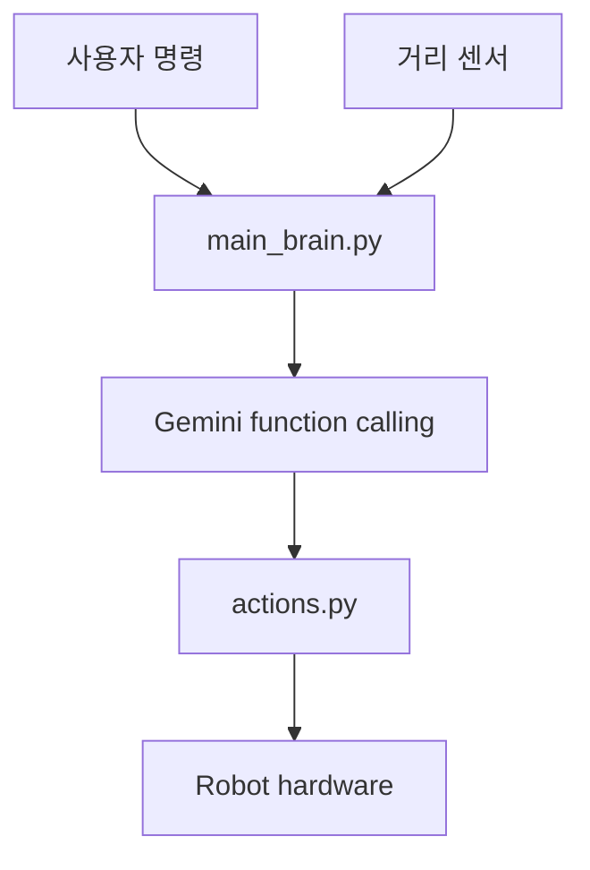

# robot

Raspberry Pi 기반 로봇을 자연어 명령으로 제어하는 Python 프로젝트입니다.

사용자가 "앞으로 가", "멈춰", "돌아"처럼 명령하면 `main_brain.py`가 현재 거리 정보와 명령을 Gemini에 전달하고, Gemini는 허용된 함수 목록 중 하나를 선택합니다. 선택된 함수는 `actions.py`를 통해 로봇의 움직임이나 음성 응답으로 이어집니다.

## 작동 방식

이 프로젝트는 실제 로봇 동작을 목표로 만든 제어 흐름입니다.

- 사용자 명령을 입력받습니다.
- 전방 장애물 거리 정보를 함께 사용합니다.
- Gemini function calling으로 행동을 선택합니다.
- 로봇은 앞으로 이동, 정지, 회전, 음성 응답 중 필요한 행동을 수행합니다.
- 전방 20cm 이내에 장애물이 있으면 앞으로 이동하지 않도록 안전 조건을 둡니다.

## 주요 파일

| 파일 | 역할 |
| --- | --- |
| `main_brain.py` | 명령과 거리 정보를 Gemini에 전달하고 function call 결과를 실행합니다. |
| `actions.py` | 로봇 행동 함수와 한국어 음성 응답을 정의합니다. |
| `hardware.py` | 하드웨어 제어 함수를 분리하기 위한 인터페이스입니다. |
| `2main_brain.py` | 이전 Gemini SDK 기반 실험 코드입니다. |
| `test_case.py` | 로컬 테스트용 실행 파일입니다. |

## 기술 스택

- Python 3
- Raspberry Pi
- Google Gemini API
- `google-genai`
- `google-generativeai`
- `python-dotenv`
- gTTS
- pygame

## 구조



## 실행 준비

```bash
python3 -m venv .venv
source .venv/bin/activate
pip install -r requirements.txt
cp .env.example .env
```

`.env` 파일에 Google API 키를 넣습니다.

```text
GOOGLE_API_KEY=your-google-api-key
```

실제 API 키는 `.env`에만 보관하고 Git에 커밋하지 않습니다.

## 실행

```bash
python main_brain.py
```

Windows PowerShell에서 테스트할 때는 다음처럼 실행할 수 있습니다.

```powershell
python -m venv .venv
.\.venv\Scripts\Activate.ps1
pip install -r requirements.txt
Copy-Item .env.example .env
python main_brain.py
```

## 문서

- [아키텍처](docs/architecture.md)
- [라즈베리파이 설정](docs/raspberry-pi-setup.md)
- [배선 가이드](docs/wiring.md)
- [공개 전 체크리스트](docs/publication-checklist.md)
