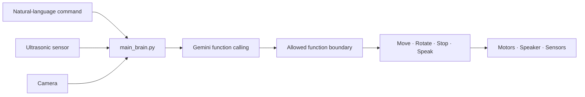

# Gemini Raspberry Pi Robot

> A physical robot that turns natural-language commands into<br>
> constrained and safe motor actions using Gemini function calling.

[Watch Demo](#demo) · [Architecture](docs/architecture.md) · [Hardware Setup](docs/raspberry-pi-setup.md) · [한국어 문서](#한국어-문서)

<p align="center">
  
</p>

## What It Can Do

- Execute multi-step natural-language commands
- Inspect objects with a camera
- Avoid obstacles with an ultrasonic sensor
- Move, rotate, stop, and speak through allowed functions

## How It Works



1. The robot collects the user's command and current sensor state.
2. `main_brain.py` sends that context and a fixed function schema to Gemini.
3. Gemini selects only from the functions exposed by the application.
4. `actions.py` validates the selected action before the hardware layer executes it.
5. The robot can inspect the result and continue with the next step of a compound command.

The model never receives unrestricted control of the operating system or GPIO pins. Motor actions pass through a constrained function boundary, and forward motion is blocked when an obstacle is detected within the configured safety distance.

## Demo

Click a thumbnail to watch the corresponding robot test on YouTube.

| Demo | Capability |
| --- | --- |
| <a href="https://youtu.be/QIJOv5Q-LHc"></a> | **Approach an obstacle safely**<br>Uses distance context while moving forward. |
| <a href="https://youtu.be/0o1b3L9IwOY"></a> | **Inspect an object and move**<br>Combines camera input with a movement command. |
| <a href="https://youtu.be/ix_nwpkvWfA"></a> | **Speak and play audio**<br>Uses the attached speaker for audio output. |
| <a href="https://youtube.com/shorts/KLmq6Mq9xEY?feature=share"></a> | **Repeat movement sequences**<br>Executes a multi-step natural-language instruction. |
| <a href="https://youtube.com/shorts/O0WwkEZf5KQ?feature=share"></a> | **Inspect after moving**<br>Re-evaluates camera input after a physical action. |

## Hardware

- Raspberry Pi 5
- L298N motor driver
- Two-wheel DC motor chassis with a separate motor power supply
- HC-SR04 ultrasonic distance sensor
- USB camera
- Microphone and speaker or USB audio device

See the [Raspberry Pi setup guide](docs/raspberry-pi-setup.md) and [wiring guide](docs/wiring.md) before connecting or powering the motors.

## Quick Start

```bash
python3 -m venv .venv
source .venv/bin/activate
pip install -r requirements.txt
cp .env.example .env
```

Add your Gemini API configuration to `.env`:

```text
GOOGLE_API_KEY=your-google-api-key
GEMINI_MODEL=gemini-2.5-flash
```

Run the main controller:

```bash
python main_brain.py
```

Run the simulated command and distance test without driving the physical robot:

```bash
python test_case.py
```

## Project Structure

| Path | Responsibility |
| --- | --- |
| `main_brain.py` | Sends commands and sensor context to Gemini and handles function calls. |
| `actions.py` | Defines the allowed move, stop, rotate, and speech functions. |
| `hardware.py` | Separates physical GPIO control from local development and tests. |
| `2main_brain.py` | Preserves an earlier experiment using the `google-generativeai` SDK. |
| `test_case.py` | Exercises the decision flow with simulated commands and distance values. |
| `docs/` | Contains architecture, setup, wiring, and publication notes. |

## Safety

- Do not power the motors directly from the Raspberry Pi 5V pin.
- Use a common ground between the Raspberry Pi and the motor driver.
- Pass the HC-SR04 ECHO signal through a voltage divider or level shifter.
- Perform the first movement test with the wheels raised off the floor.
- Verify the stop function and physical power cutoff before driving the robot.
- Keep obstacle avoidance checks outside the model response and inside executable application logic.

## 한국어 문서

이 프로젝트는 Raspberry Pi 이동 로봇에 Gemini function calling을 연결해 자연어 명령을 실제 행동으로 변환합니다. 거리 센서와 카메라로 주변 상황을 확인하고, 미리 허용된 함수 안에서만 이동·정지·회전·음성 응답을 수행하도록 구성했습니다.

Gemini가 GPIO나 운영체제를 직접 제어하는 대신 `actions.py`에 정의된 행동을 선택하고, 애플리케이션이 안전 조건을 검사한 뒤 `hardware.py`를 통해 실행하는 구조입니다. 전방의 장애물이 설정 거리 안에 있으면 모델의 응답과 관계없이 전진을 차단합니다.

- [아키텍처 상세](docs/architecture.md)
- [Raspberry Pi 설정](docs/raspberry-pi-setup.md)
- [배선 가이드](docs/wiring.md)
- [공개 전 체크리스트](docs/publication-checklist.md)

## Build Gallery

| Controller | Chassis | Wiring |
| --- | --- | --- |
|  |  |  |
