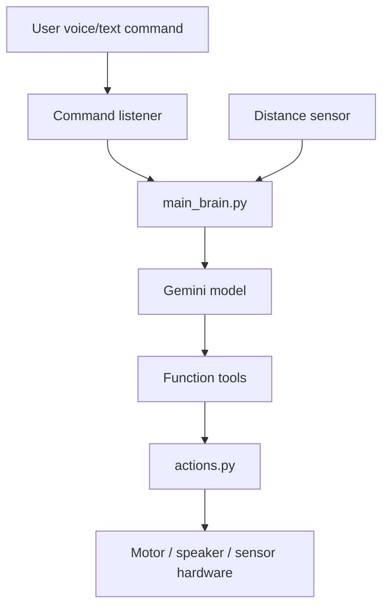
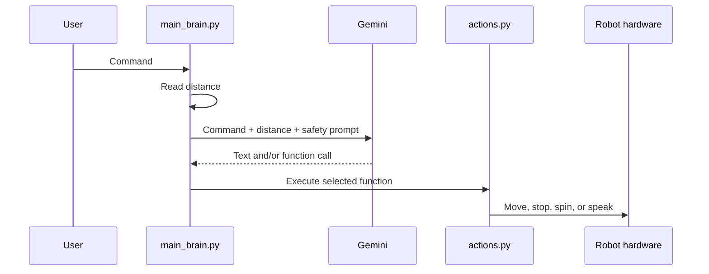

# Architecture

## System Overview

## Runtime Decision Flow

## Module Roles

| File | Role |
| --- | --- |
| `main_brain.py` | Primary Gemini function-calling experiment using `google-genai`. |
| `2main_brain.py` | Older experiment using `google-generativeai`. Keep for comparison or delete later. |
| `actions.py` | Action functions exposed to the model. |
| `hardware.py` | Virtual hardware abstraction used while GPIO integration is incomplete. |
| `test_case.py` | Small local test entrypoint. |

## Safety Boundary

The model does not directly control GPIO. It selects from a small set of Python functions. Real motor control should stay behind the `actions.py` and `hardware.py` boundary so prompts cannot execute arbitrary code.
