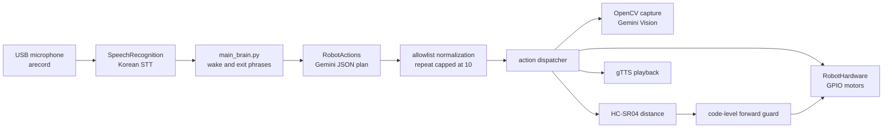

# Architecture

[English](architecture.md) | [한국어](ko/architecture.md)

This document describes the verified execution path in the restored May 28, 2026 integrated source. The difference between that source and the shortened July 9 public snapshot is recorded in the [Korean project story](ko/project-story.md).

## Runtime flow

## Module roles

`main_brain.py` loads `.env`, creates `RobotHardware` and `RobotActions`, listens for a Korean wake phrase, captures a command with retries, and passes it to `RobotActions.run_command()`.

`actions.py` asks Gemini for a JSON action plan. It does not expose arbitrary Python functions to the model and does not evaluate generated code. It parses the JSON, normalizes action names, caps repeats at ten, and dispatches only known actions. API or JSON failures use a rule-based command fallback.

`hardware.py` is connected to the primary runtime and contains the current device layer:

| Device | Verified implementation |
| --- | --- |
| Motors | BCM GPIO 5, 6, 16, and 26 |
| Ultrasonic sensor | HC-SR04, TRIG 23 and ECHO 24 |
| Command LED | BCM GPIO 25 |
| Camera | OpenCV `VideoCapture`, default index 1, 640×480 JPEG |
| Speech input | `arecord` raw stream and Google Korean recognition |
| Speech output | gTTS cache with `mpg123` or `ffplay` |

## Vision and object approach

Scene questions, visual conditions, and object approach capture a JPEG and send it to Gemini Vision. Object approach repeats for at most seven steps. Each step checks ultrasonic distance, captures a new image, requests JSON alignment guidance, and then turns or advances briefly.

This path has network and vision latency. A camera result is not a safety guarantee.

## Safety boundary

The current source includes deterministic checks as well as model prompts:

- `move_forward()` reads a fresh distance and rejects forward motion at or below 25 cm by default.
- Continuous forward motion rechecks distance and stops at 18 cm by default.
- Object approach checks distance before each step.
- A stuck-high ECHO signal and measurement exceptions return 0 cm, producing a stop.
- Shutdown attempts motor stop, camera release, and GPIO cleanup.

Known limits remain:

- An ECHO-rise timeout is currently treated as the maximum distance (400 cm), rather than a fail-stop state.
- There are no rear or side sensors and no physical emergency-stop implementation.
- Timed motor actions vary with floor friction, load, and battery voltage.
- Speech recognition and Gemini Vision can be wrong.
- The rule fallback can misclassify action order and targets in compound commands.

Use an accessible motor power switch, test with wheels raised, and begin at low speed in an open area.

## Supporting files

- `test_case.py` inspects command planning without calling hardware methods. It uses the rule fallback when no API key is configured.
- `2main_brain.py` is a legacy experiment that expects a missing `robot` object. It is not the current entrypoint and is not runnable as-is.

## Recommended improvements

- Treat all sensor timeouts as explicit fail-stop states.
- Validate per-action duration and count limits with tests.
- Add fake device adapters for hardware-free unit tests.
- Add a physical emergency stop, more directional sensors, and battery monitoring.
- Measure audio, camera, and API latency and evaluate asynchronous or local alternatives.
- Archive or remove the legacy `2main_brain.py` path.
