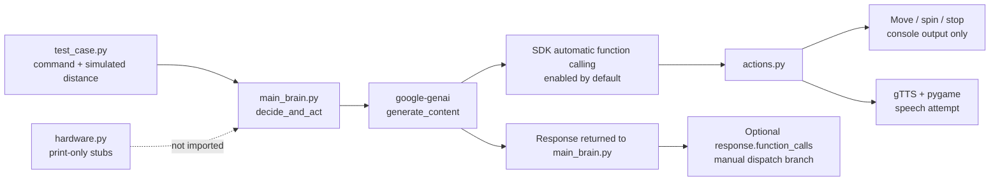
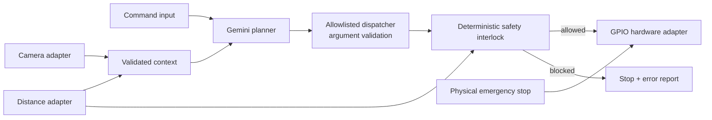

# Architecture

[English](architecture.md) | [한국어](ko/architecture.md)

## Verified Public-Code Flow

`test_case.py` is the only runnable example entrypoint. Importing `main_brain.py` requires `GOOGLE_API_KEY`, creates a Gemini client, and defines `decide_and_act`. The test file calls that function with three hard-coded commands and distance numbers.

`main_brain.py` passes Python callables directly in `GenerateContentConfig.tools`. According to the current [Google Gen AI Python SDK documentation](https://googleapis.github.io/python-genai/), automatic Python function calling is enabled unless explicitly disabled. This repository does not disable it. The SDK can therefore execute an action during `generate_content`. The code then also checks `response.function_calls` and manually invokes matching globals if calls are still exposed in the returned response. Exact response details can vary with the installed SDK because `requirements.txt` sets only a minimum version.

## Verified Module Roles

| File | Current role |
| --- | --- |
| `main_brain.py` | Configures Gemini, provides four Python function tools, builds the prompt, and inspects the response. |
| `actions.py` | Provides gTTS/pygame speech plus print-only forward, spin, and stop functions. |
| `hardware.py` | Provides another set of print-only functions; it is not imported by the primary flow. |
| `test_case.py` | Makes three live Gemini API calls with simulated distance values. |
| `2main_brain.py` | Legacy reference that cannot currently import `robot` and also expects a missing `move_backward` function. |

## Safety Boundary

The prompt tells Gemini not to move forward when the supplied distance is at or below 20 cm. No application condition checks that value before an action runs. The current 20 cm rule is therefore guidance to the model, not a deterministic safety interlock.

The public movement functions do not control GPIO, which limits the immediate physical risk of this snapshot. Before adding real motor code, introduce a code-level validator that checks fresh sensor data, action names, arguments, duration limits, stop state, and hardware errors immediately before execution.

## Features Outside the Current Path

The primary public path does not contain microphone input, a command loop, HC-SR04 reads, camera capture, image input, GPIO setup, motor drivers, or post-action visual inspection. Those features appear in physical prototype recordings but are not reproducible from this code alone.

## Recommended Future Architecture

The following diagram is a recommendation, not the current implementation.

Keep model planning, deterministic safety policy, and device drivers as separate layers. Tests should use fake sensor and hardware implementations, while Raspberry Pi-specific code should remain behind explicit interfaces.
