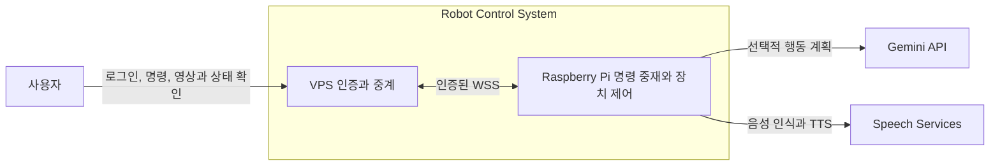
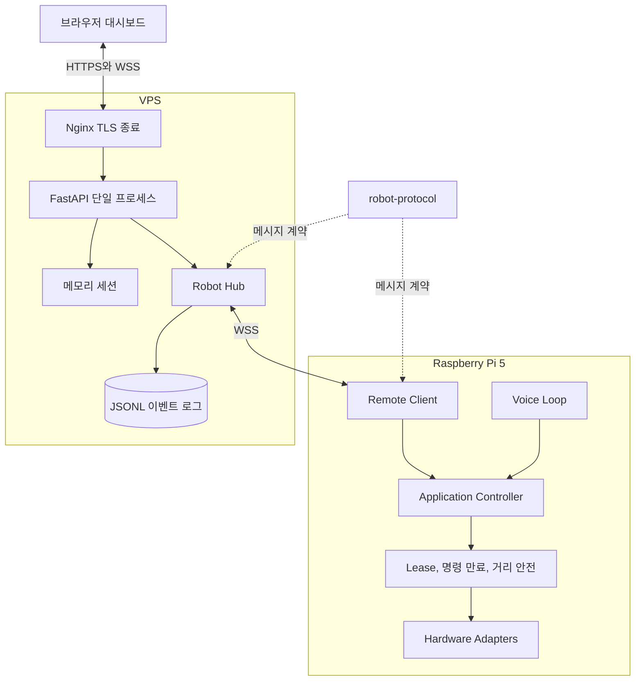
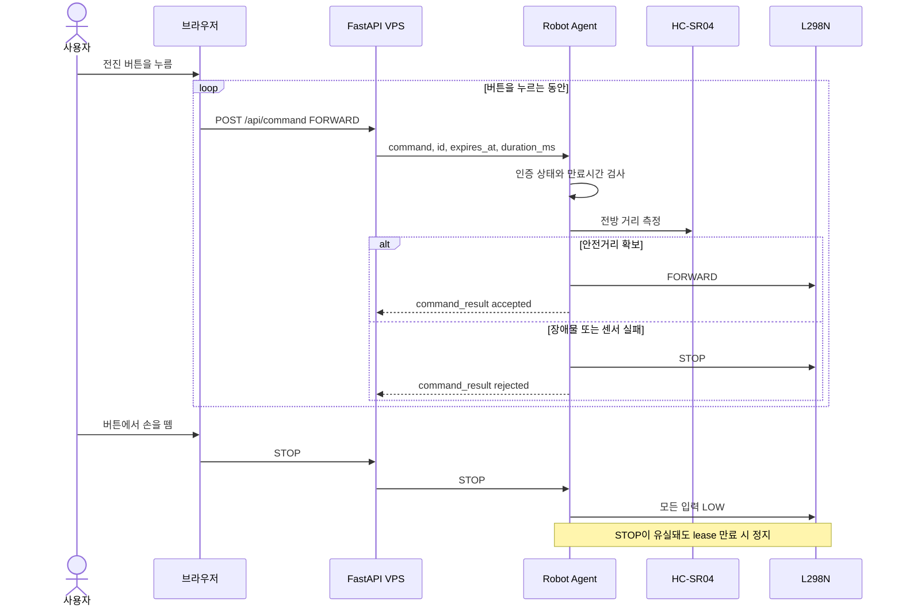
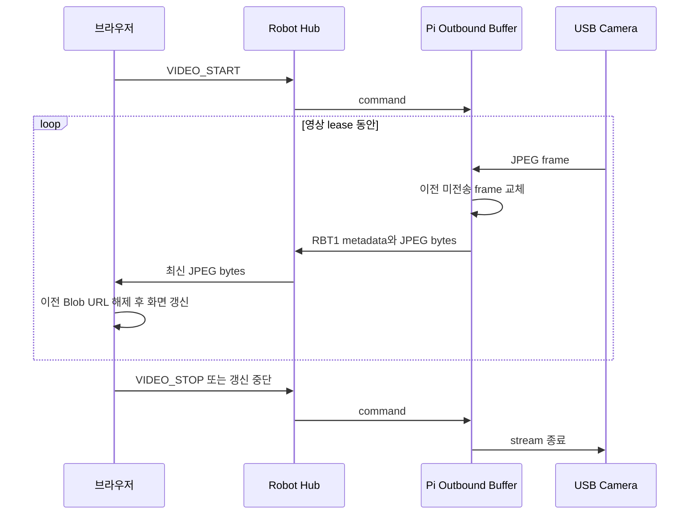

# 시스템 아키텍처

## 설계 목표

이 시스템은 인터넷을 통해 소형 이동 로봇을 제어하면서도 네트워크와 VPS를 안전의 단일 실패 지점으로 만들지 않는 것을 목표로 합니다.

- 모터를 움직일 수 있는 최종 권한은 Raspberry Pi에 둡니다.
- 브라우저와 VPS 연결이 끊기면 마지막 주행 명령이 계속되지 않아야 합니다.
- 영상 지연이 누적될 때 오래된 프레임보다 현재 장면을 우선합니다.
- 로봇과 서버는 독립적으로 배포하되 통신 계약은 한 곳에서 관리합니다.
- 하드웨어 없이도 대부분의 제어 흐름을 자동 테스트할 수 있어야 합니다.

## 시스템 컨텍스트



Raspberry Pi는 외부에서 들어오는 포트를 열지 않고 VPS로 먼저 WSS 연결을 만듭니다. 따라서 공개 네트워크에 노출되는 구성요소는 Nginx와 FastAPI 서버뿐입니다.

## 컨테이너와 책임



### Raspberry Pi 애플리케이션

`robot/src/robot_app`은 하드웨어와 애플리케이션 규칙을 분리한 계층 구조를 사용합니다.

| 영역 | 역할 |
|---|---|
| `bootstrap.py`, `config.py` | 환경 설정 검증과 의존성 조립 |
| `domain/` | 명령, 상태와 하드웨어 포트 정의 |
| `application/` | 로컬 음성과 원격 명령 중재, lease와 안전정지 |
| `actions/` | 자연어 행동 계획과 실행 서비스 |
| `hardware/` | 모터, 초음파, LED, 카메라와 오디오 어댑터 |
| `infrastructure/` | VPS WebSocket, 전송 버퍼와 선택적 GNSS 연동 |
| `intelligence/` | Gemini 클라이언트와 제한시간 처리 |

애플리케이션 계층은 GPIO 모듈을 직접 호출하지 않고 포트를 통해 하드웨어를 사용합니다. 이 경계 덕분에 테스트 더블로 lease 만료, 센서 실패와 명령 충돌을 검증할 수 있습니다.

### VPS 애플리케이션

`server/server`는 FastAPI 진입점, 라우터와 상태 서비스를 분리합니다.

| 영역 | 역할 |
|---|---|
| `app.py`, `config.py` | 애플리케이션 생성과 환경 설정 |
| `schemas.py`, `dependencies.py` | HTTP 입력 검증과 세션 의존성 |
| `routers/` | 페이지, 상태, 세션, 명령과 WebSocket 엔드포인트 |
| `services/robot_hub.py` | 단일 로봇 연결과 대시보드 팬아웃 |
| `services/robot_messages.py` | 로봇 이벤트 검증과 상태 반영 |
| `services/sessions.py` | HttpOnly 쿠키 기반 메모리 세션 |
| `services/event_log.py` | JSONL 이벤트 기록 |
| `static/` | 모듈화된 브라우저 대시보드 |

Robot Hub와 세션이 메모리에 있으므로 Uvicorn은 반드시 worker 1개로 실행합니다. 여러 worker가 필요해지면 연결 상태와 세션을 Redis 같은 외부 저장소로 이동해야 합니다.

### 공통 프로토콜

`packages/robot-protocol`은 Python 표준 라이브러리만 사용하는 독립 패키지입니다.

- 양쪽이 사용하는 action과 message type
- hello와 command 메시지 모델
- 프로토콜 버전과 호환성 검사
- `RBT1` 바이너리 프레임 인코딩과 디코딩

두 애플리케이션은 각각의 가상환경에 이 패키지를 설치합니다. 동일 파일을 각 폴더에 복사하지 않으므로 한쪽만 수정돼 통신이 깨지는 상황을 줄입니다.

## 원격 주행 흐름



브라우저가 백그라운드로 이동하거나 포인터가 취소될 때도 STOP을 전송합니다. 이 요청까지 유실되는 경우에는 Raspberry Pi의 주행 lease가 마지막 방어선으로 작동합니다.

## 영상 흐름과 backpressure



카메라와 텔레메트리는 최신 항목으로 교체할 수 있는 데이터입니다. 반대로 명령 결과와 상태 변경은 의미를 잃지 않도록 우선 큐로 보냅니다. WebSocket 송신이 설정된 제한시간 안에 끝나지 않으면 연결을 닫고 재연결해 무한 backlog를 피합니다.

## 장애 발생 시 동작

| 장애 | 방어 동작 |
|---|---|
| 브라우저 입력 중단 | STOP 전송, 이후 Pi lease 만료 |
| VPS와 Pi 연결 단절 | Pi가 원격 연결 해제를 감지하고 모터 정지 |
| 명령 전달 지연 | `expires_at`이 지난 명령 거부 |
| 초음파 센서 비활성 또는 읽기 실패 | 실제 Pi에서는 0cm fail-safe로 전진 차단 |
| WebSocket 송신 정체 | 제한시간 후 연결 재수립, 영상과 텔레메트리 최신 값 유지 |
| 카메라 중단 | 마지막 프레임을 화면에서 제거하고 연결 상태 표시 |
| 오디오 장치 번호 변경 | ALSA 카드 이름으로 장치 선택, 실패 시 backoff |
| Gemini 응답 지연 | 요청 제한시간 후 규칙 기반 처리 또는 오류 보고 |

## 신뢰 경계와 데이터

- `ROBOT_TOKEN`은 Pi와 VPS 사이의 장치 인증에만 사용합니다.
- `DASHBOARD_KEY`는 사용자가 세션을 만드는 로그인 입력입니다.
- 로그인 후 브라우저는 HttpOnly와 SameSite 세션 쿠키를 사용하며 키를 WebSocket URL에 넣지 않습니다.
- 카메라, 마이크와 명령 데이터는 VPS를 통과하므로 VPS 운영자는 해당 데이터에 접근할 수 있습니다.
- 세션과 최신 상태는 메모리 데이터이며 서버 재시작 후 유지되지 않습니다.
- 이벤트 메타데이터는 `/var/lib/robot-server/events.jsonl`에 기록하지만 영상과 음성 원본은 영구 저장하지 않습니다.

## 배포 토폴로지

```text
Raspberry Pi
/home/dslab/Desktop/robot-pj/
├─ packages/robot-protocol/
└─ robot/
   ├─ .venv/
   └─ .env

VPS
/opt/robot-pj/
├─ packages/robot-protocol/
└─ server/
   └─ .venv/

/etc/robot-server.env
/var/lib/robot-server/events.jsonl
```

양쪽 모두 전체 모노레포를 checkout하고 필요한 애플리케이션만 실행합니다. 실제 명령과 권한은 [Raspberry Pi 배포](deployment/raspberry-pi.md)와 [VPS 배포](deployment/vps.md)에 정리했습니다.

## 현재 제약

- Robot Hub는 로봇 한 대만 관리합니다.
- 세션과 상태가 메모리에 있어 서버 다중 worker와 수평 확장을 지원하지 않습니다.
- 영상은 기본 848x480, 약 4fps의 JPEG 프레임이며 네트워크 상황에 따른 비트레이트 자동 조정이 없습니다.
- 음성 오디오는 JSON의 Base64로 전달하므로 바이너리 전송보다 대역폭 비용이 큽니다.
- GNSS 백엔드는 실험적으로 남아 있지만 현재 웹 화면에서는 위치 기능을 제공하지 않습니다.
- 구조화된 메트릭, 분산 추적과 중앙 로그 수집은 아직 없습니다.
- CI는 공통 패키지와 두 애플리케이션을 자동 검증하지만, 무중단 배포와 자동 rollback은 아직 제공하지 않습니다.
