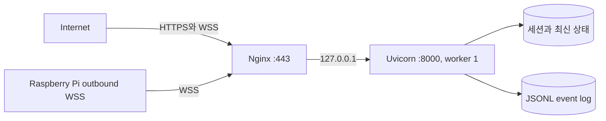

# VPS 배포

VPS는 Nginx에서 TLS를 종료하고, Uvicorn worker 1개로 FastAPI 애플리케이션을 실행합니다. 로봇 연결, 대시보드 연결과 세션이 프로세스 메모리에 있으므로 worker 수를 임의로 늘리면 안 됩니다.

## 고정 경로

| 항목 | 경로 |
|---|---|
| 저장소 루트 | `/opt/robot-pj` |
| 애플리케이션 | `/opt/robot-pj/server` |
| 가상환경 | `/opt/robot-pj/server/.venv` |
| 환경 파일 | `/etc/robot-server.env` |
| 이벤트 로그 | `/var/lib/robot-server/events.jsonl` |
| systemd unit | `/etc/systemd/system/robot-server.service` |

## 배포 토폴로지



## 1. 서비스 계정과 디렉터리

```bash
sudo useradd --system --home /opt/robot-pj --shell /usr/sbin/nologin robotapp 2>/dev/null || true
sudo install -d -o robotapp -g robotapp -m 0755 /opt/robot-pj
sudo install -d -o robotapp -g robotapp -m 0750 /var/lib/robot-server
```

비공개 저장소 접근에는 읽기 전용 deploy key를 권장합니다. 실제 key와 토큰을 저장소나 배포 로그에 넣지 않습니다.

```bash
sudo -u robotapp git clone <PRIVATE_REPOSITORY_URL> /opt/robot-pj
```

## 2. Python 환경

```bash
cd /opt/robot-pj/server
sudo -u robotapp python3 -m venv .venv
sudo -u robotapp .venv/bin/python -m pip install --upgrade pip setuptools wheel
sudo -u robotapp .venv/bin/python -m pip install -r requirements.txt
```

`requirements.txt`는 같은 checkout의 `../packages/robot-protocol`을 설치합니다. 서버 폴더만 단독 복사하면 공통 패키지를 찾을 수 없으므로 전체 모노레포를 배포합니다.

## 3. 비밀값과 영속 경로

```bash
sudo install -o root -g root -m 0600 /dev/null /etc/robot-server.env
sudoedit /etc/robot-server.env
```

```dotenv
ROBOT_ID=robot-01
ROBOT_TOKEN=<Pi와_동일한_긴_무작위_값>
DASHBOARD_KEY=<ROBOT_TOKEN과_다른_긴_무작위_값>
SESSION_HOURS=12
SESSION_COOKIE_SECURE=auto
EVENT_LOG_PATH=/var/lib/robot-server/events.jsonl
WEBSOCKET_SEND_TIMEOUT=5
```

`EVENT_LOG_PATH`를 source tree 아래에 두면 `ProtectSystem=strict`와 충돌합니다. 서비스가 쓸 수 있도록 반드시 `/var/lib/robot-server` 아래를 사용합니다.

## 4. systemd

```bash
cd /opt/robot-pj
sudo install -m 0644 server/deploy/robot-server.service /etc/systemd/system/robot-server.service
sudo systemctl daemon-reload
sudo systemctl enable --now robot-server.service
sudo systemctl --no-pager --full status robot-server.service
```

실행 명령은 다음과 같아야 합니다.

```text
/opt/robot-pj/server/.venv/bin/uvicorn server.app:app \
  --host 127.0.0.1 --port 8000 --workers 1
```

내부 상태가 메모리에 있으므로 `--workers 1`을 유지합니다.

## 5. Nginx와 TLS

```bash
sudo install -m 0644 /opt/robot-pj/server/deploy/nginx-robot.conf /etc/nginx/sites-available/robot
sudo ln -s /etc/nginx/sites-available/robot /etc/nginx/sites-enabled/robot
sudo nginx -t
sudo systemctl reload nginx
```

예시 설정의 `server_name`과 인증서 경로를 실제 도메인 또는 인증된 IP에 맞게 수정합니다. HTTP는 HTTPS로 전환하고 `/ws/robot`과 `/ws/dashboard`에서 WebSocket upgrade header를 유지해야 합니다.

방화벽은 공개 HTTPS에 필요한 포트만 허용합니다. Uvicorn의 8000 포트는 `127.0.0.1`에만 bind합니다.

## 6. 검증

```bash
curl -fsS http://127.0.0.1:8000/health
curl -fsS https://<VPS_HOST>/health
systemctl is-active robot-server.service
journalctl -u robot-server.service -n 100 --no-pager
```

Pi가 아직 연결되지 않았다면 `status=ok`, `robot_online=false`도 정상적인 서버 기동 상태입니다. Pi 서비스가 연결된 뒤 `robot_online=true`로 바뀌어야 합니다.

## 7. 이후 업데이트

```bash
cd /opt/robot-pj
git status --short --branch
sudo systemctl stop robot-server.service
sudo -u robotapp git pull --ff-only
cd /opt/robot-pj/server
sudo -u robotapp .venv/bin/python -m pip install -r requirements.txt
sudo systemctl start robot-server.service
curl -fsS https://<VPS_HOST>/health
```

static 파일도 서버 프로세스가 직접 제공하므로 프론트 변경 후 서비스를 재시작합니다.

## 프로토콜 변경 배포 순서

Pi와 VPS를 동시에 교체할 수 없으므로 다음 순서를 사용합니다.

1. 이전 형식과 새 형식을 모두 허용하는 VPS를 배포합니다.
2. `/health`와 대시보드 로그인을 확인합니다.
3. 새 protocol package를 사용하는 Pi를 배포합니다.
4. `robot_online=true`, command result와 영상 전송을 확인합니다.
5. 충분한 전환 기간 뒤 deprecated 형식을 제거합니다.

VPS가 새 버전만 강제하도록 먼저 바꾸면 원격 Pi가 연결되지 않아 현장 접근이 필요할 수 있습니다.

## 운영 제약

- 프로세스 재시작 시 세션과 최신 상태가 초기화됩니다.
- worker 1개이므로 CPU 확장은 수평 확장보다 단일 프로세스 최적화에 의존합니다.
- JSONL 이벤트 로그 회전 정책은 OS logrotate로 별도 구성해야 합니다.
- 현재 자동 rollback과 무중단 배포는 제공하지 않습니다.
