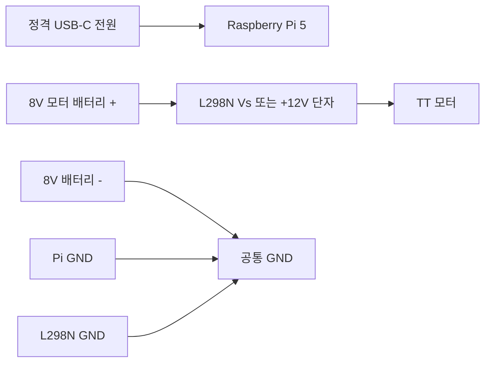

# 하드웨어 구성과 안전 조건

대상 장비는 Raspberry Pi 5, L298N 모터 드라이버, TT 모터, HC-SR04, USB UVC 카메라와 USB 오디오 장치입니다.

## 전원 구성



- 8V 배터리의 양극은 L298N의 모터 전원 `Vs` 또는 `+12V` 표기 단자에 연결합니다.
- 8V 배터리를 Raspberry Pi의 5V 또는 3.3V 핀에 연결하지 않습니다.
- Raspberry Pi는 규격에 맞는 별도 USB-C 전원으로 공급합니다.
- 배터리 음극, L298N GND와 Raspberry Pi GND를 공통으로 연결해야 제어 신호 기준 전압이 맞습니다.
- L298N 보드의 5V regulator jumper와 출력 방식은 제조사마다 다릅니다. 모듈 회로를 확인하지 않은 상태에서 L298N의 5V 단자로 Pi를 역급전하지 않습니다.
- ENA와 ENB jumper를 꽂으면 각 채널이 항상 활성화됩니다. PWM 속도 제어를 사용할 때만 jumper를 빼고 별도 신호를 연결합니다.

## L298N GPIO

BCM 번호 기준입니다.

| 신호 | GPIO |
|---|---:|
| IN1 | 5 |
| IN2 | 6 |
| IN3 | 16 |
| IN4 | 26 |

교정된 방향 mapping은 다음과 같습니다.

| 명령 | IN1 | IN2 | IN3 | IN4 |
|---|---:|---:|---:|---:|
| 전진 | 0 | 1 | 1 | 0 |
| 후진 | 1 | 0 | 0 | 1 |
| 좌회전 | 0 | 1 | 0 | 1 |
| 우회전 | 1 | 0 | 1 | 0 |
| 정지 | 0 | 0 | 0 | 0 |

이 mapping은 기존 실제 동작 관찰을 기준으로 코드에서 교정하고 테스트 더블로 확인했습니다. 교정 후 네 방향을 실제 모터로 다시 확인한 기록은 아직 없으므로 바퀴를 띄운 상태에서 한 방향씩 검증해야 합니다.

## HC-SR04

| 신호 | GPIO |
|---|---:|
| TRIG | 23 |
| ECHO | 24 |

HC-SR04 ECHO는 일반적으로 5V 신호를 출력하지만 Raspberry Pi GPIO는 3.3V 입력입니다. ECHO와 GPIO24 사이에 저항 분압 또는 적절한 level shifter를 사용해야 합니다. 5V ECHO를 GPIO에 직접 연결하면 Raspberry Pi가 손상될 수 있습니다.

기본 안전 설정은 다음과 같습니다.

```dotenv
ULTRASONIC_TRIG=23
ULTRASONIC_ECHO=24
SAFE_DISTANCE_CM=25
ULTRASONIC_STOP_CM=18
ULTRASONIC_MAX_CM=400
ULTRASONIC_TIMEOUT_IS_CLEAR=0
```

`ULTRASONIC_TIMEOUT_IS_CLEAR=0`은 반사파 timeout을 빈 공간이 아니라 센서 실패로 처리합니다. 실제 Raspberry Pi에서 `ULTRASONIC_ENABLED=0`인 경우도 0cm fail-safe로 전진을 차단합니다.

센서를 활성화하기 전 다음을 확인합니다.

1. 3.3V level 변환
2. TRIG와 ECHO 핀 번호
3. 짧은 거리, 중간 거리와 빈 공간에서 반복 측정
4. 장애물을 가까이 둘 때 전진 거절
5. ECHO 선을 분리했을 때 전진 거절

## 카메라

운영 장치에서 확인된 카메라는 Realtek `0bda:5856 HD WEB CAMERA` USB UVC 장치입니다.

- 영상 노드: `/dev/video0`, `/dev/video1`
- 애플리케이션 기준 장치: `CAMERA_INDEX=0`
- 권장 입력: MJPEG, 848x480, 30fps
- 원격 전송: 기본 4fps, JPEG 품질 70
- 자동초점: 장치가 지원하면 활성화
- 시작 직후 노출과 초점 안정화를 위해 warmup frame 폐기

`rpicam-hello`는 CSI 카메라용 도구이므로 USB 카메라를 찾지 못해도 USB UVC 장애를 의미하지 않습니다.

초점이 맞지 않을 때는 해상도보다 조명, 피사체 거리, 렌즈 오염과 자동초점 수렴 시간을 먼저 확인합니다. 영상 지연은 카메라 frame rate보다 네트워크, JPEG 인코딩과 소비자 처리 속도의 영향을 함께 받습니다.

## 오디오

USB 장치 번호는 재연결 순서에 따라 바뀔 수 있으므로 ALSA 카드 이름을 사용합니다.

```dotenv
AUDIO_DEVICE=plughw:CARD=CAMERA,DEV=0
AUDIO_OUTPUT_DEVICE=plughw:CARD=UACDemoV10,DEV=0
AUDIO_SAMPLE_RATE=48000
AUDIO_ERROR_BACKOFF_SEC=3
AUDIO_ERROR_LOG_INTERVAL_SEC=15
```

- 웹캠 마이크: `CARD=CAMERA`
- USB 오디오 출력: `CARD=UACDemoV10`
- 실제 사용자 `dslab`은 `audio`와 `video` 그룹에 포함돼야 합니다.
- 장치가 사라지면 빠른 무한 재시도 대신 backoff 후 다시 확인합니다.

장치 이름은 다음 명령으로 확인합니다.

```bash
arecord -L
aplay -L
v4l2-ctl --list-devices
```

## USB 안정성

운영 기록에는 USB 허브 장치의 분리와 재연결, descriptor 오류 `-32`가 한 차례 있었습니다. 카메라나 오디오가 간헐적으로 끊길 때는 다음 순서로 확인합니다.

1. USB 허브의 외부 전원 용량
2. 카메라와 오디오 케이블 접촉
3. Raspberry Pi 전원 저전압 경고
4. `dmesg`의 UVC와 USB audio 재연결 기록
5. 장치 이름이 ALSA와 V4L2에 다시 나타나는지 확인

## 모터 시험 전 체크리스트

1. 바퀴가 바닥에서 완전히 떠 있습니다.
2. 8V 모터 전원을 즉시 분리할 수 있습니다.
3. Raspberry Pi와 L298N의 공통 GND가 유지됩니다.
4. ENA, ENB jumper와 IN1부터 IN4 배선을 확인했습니다.
5. HC-SR04 ECHO level 변환을 확인했습니다.
6. 주변에 사람, 케이블과 장애물이 없습니다.
7. `robot.service`를 중지하고 inactive 상태를 확인했습니다.

한 동작을 정확히 한 번 실행하고 `finally`에서 IN1부터 IN4를 LOW로 만든 뒤 GPIO를 정리합니다. 예상과 다른 방향으로 움직여도 코드나 배선을 자동으로 다시 바꾸지 않고 실제 결과를 기록합니다.

## 현재 물리 검증 상태

| 항목 | 상태 |
|---|---|
| USB 카메라 사진 | 성공 |
| 마이크 3초 녹음 | 성공 |
| 사용자 승인 후 스피커 재생 | 성공 |
| GPIO 모듈과 Pi 정보 | 성공 |
| 기존 mapping 짧은 모터 동작 | 한 번 수행 후 LOW 정리 |
| 교정된 네 방향 | 미완료 |
| HC-SR04 다회 측정 | 미완료 |
| 브라우저 원격 주행 | 미완료 |
