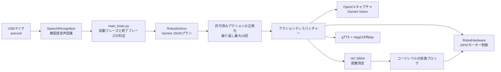

# アーキテクチャ

[English](../architecture.md) | [한국어](../ko/architecture.md) | [日本語](architecture.md)

この文書では、2026年5月28日の最終統合版を基準に、現在公開されているコードで実際につながっている呼び出し経路を説明します。7月9日に最初に公開された簡略版との違いは、[プロジェクトの制作と復元の記録](project-story.md)にまとめています。

## 全体の実行フロー



## 1. `main_brain.py`: 音声コマンドループ

プログラムは最初に `.env` を読み込み、`RobotHardware` と `RobotActions` を生成します。その後、次の手順を繰り返します。

1. マイクから韓国語の音声を聞き取ります。
2. `명령 시작` 系の起動フレーズを確認します。
3. コマンドを聞き取り、認識に失敗した場合は1回再試行します。合計で最大2回試行します。
4. 認識した文を `RobotActions.handle_command()` に渡します。
5. `종료`、`꺼져`、`끝내`、`그만` 系のコマンドであれば、後処理を行って終了します。

`main_brain.py` は画像やGPIOを直接扱いません。デバイスへのアクセスは `hardware.py`、判断と実行順序は `actions.py` に分かれています。

## 2. `actions.py`: JSONプランと許可リストによるディスパッチ

現在の実装は、Python関数をGemini SDKに直接渡す自動function calling方式ではありません。Geminiにコマンド分類ルールを渡し、次のようなJSONプランだけを受け取ります。

```json
{
  "steps": [
    {"action": "MOVE_FORWARD", "repeat": 1, "object_name": ""}
  ]
}
```

応答からコードブロックの記号を取り除き、`json.loads` で解析します。その後、許可されたアクション名と繰り返し回数を正規化し、繰り返しは最大10回に制限します。モデル呼び出しまたはJSON解析に失敗した場合は、ルールベースのコマンド判定に切り替えます。

主なアクションは、前進、後退、左右への旋回、停止、障害物までの前進、距離の質問、シーンの質問、物体への接近、音声応答です。文字列を `eval` したり、モデルが生成した任意のPythonコードを実行したりすることはありません。

## 3. `hardware.py`: デバイス層

`hardware.py` は現在の主要な実行経路に接続されています。`RobotHardware` は次の機能を提供します。

| 機能 | 現在の実装 |
| --- | --- |
| モーター | BCM GPIO 5、6、16、26で左右のモーター方向を制御 |
| 距離 | HC-SR04 TRIG 23、ECHO 24、有効な測定値の中央値による測定 |
| ステータスLED | BCM GPIO 25 |
| カメラ | OpenCV `VideoCapture`、デフォルトのインデックス1、640×480 JPEG |
| 音声入力 | `arecord` のrawストリームとGoogleの韓国語音声認識 |
| 音声出力 | gTTSキャッシュと `mpg123`、代替経路として `ffplay` |

`RPi.GPIO` を読み込めない場合はテストモードのメッセージを出力しますが、カメラ、オーディオ、ネットワーク機能まで自動的にモック化されるわけではありません。

## Gemini Visionの処理フロー

シーンに関する質問、条件付きの視覚判断、物体への接近では、`capture_image()` でJPEGを保存し、Geminiに画像と質問を送信します。物体への接近では、最大7回まで次の処理を繰り返します。

1. 超音波センサーの距離が目標停止距離以下か確認します。
2. 画像を撮影します。
3. Gemini Visionに物体の位置と補正方向をJSON形式で要求します。
4. 左右の位置合わせ、または短い前進を実行します。

各ステップでネットワーク通信と画像解析が発生するため、反応が遅くなることがあります。カメラの認識結果だけで安全を保証することはできません。

## 安全境界

安全条件はプロンプトだけでなく、デバイス層にも一部実装されています。

- `move_forward()` は実行直前に新しい距離値を読み取り、デフォルトでは25 cm以下の場合に前進を拒否します。
- `move_forward_until_obstacle()` は走行中に距離を繰り返し測定し、デフォルトでは18 cm以下で停止します。
- 物体への接近では、各ステップの前に超音波センサーの距離を再確認します。
- 距離は3回測定し、有効値が1件でもあれば有効値だけの中央値を使用します。有効値がない場合は、測定開始時からECHOがHIGHのままだった試行があれば0 cm、そうでなくタイムアウトした試行があれば400 cm、3回とも例外で失敗した場合は0 cmとして扱います。
- 終了時には、モーター停止、カメラ解放、GPIOのクリーンアップを試みます。

ただし、完全な安全システムではありません。

- タイムアウトには、ECHOの立ち上がりまたは立ち下がり待ちの超過と、2 cmから400 cmの測定範囲外の値が含まれます。有効値がなくタイムアウトだけが発生した場合は400 cmとして扱うため、異常時に必ず停止する仕組みではありません。
- 後方と側面のセンサーはなく、物理的な緊急停止ボタンもコードに含まれていません。
- 固定時間によるモーター制御のため、床面、バッテリー電圧、負荷によって実際の移動量が変わります。
- モデルの視覚判断と音声認識は誤ることがあります。
- ルールベースの代替分類では、複合文のアクション順序や対象を正確に分解できない場合があります。

そのため、車輪を浮かせた状態での試験、低速運転、十分な空間、すぐに切断できるモーター電源が必要です。

## 補助ファイル

- `test_case.py`: 実際のデバイスメソッドを呼び出さず、コマンドプランの結果だけを確認します。APIキーがない場合は、ルールベースの代替経路を使用します。
- `2main_brain.py`: 以前のSDKと、現在は存在しない `robot` オブジェクトを使用する過去の実験ファイルです。現在のエントリーポイントではなく、そのままでは実行できません。

## 今後推奨される改善

以下は現在の実装ではなく、今後の改善項目です。

- センサーのタイムアウトも異常として停止するよう統一し、エラー状態を別に返す
- 許可されたアクションごとの継続時間と回数の上限を、設定ファイルとテストで固定する
- モーター制御とセンサー層に仮想実装を用意し、ハードウェアなしで実行できる単体テストを追加する
- 物理的な緊急停止、後方と側面のセンサー、バッテリー電圧監視を追加する
- オーディオ、カメラ、Geminiの遅延を計測し、非同期処理またはローカルモデルを検討する
- `2main_brain.py` を別の保管場所へ移動するか削除する
