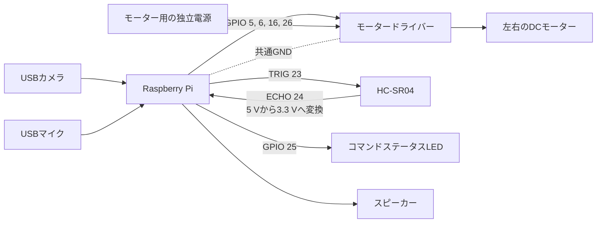

# 配線ガイド

[English](../wiring.md) | [한국어](../ko/wiring.md) | [日本語](wiring.md)

この文書は、現在の `hardware.py` に設定されているBCMピンを基準にしています。実際の車体へ再接続する際は、モータードライバーのデータシートとRaspberry Piのピン配置も併せて確認してください。

## 配線構成図

## 現在のコードで使用するBCMピン

| 構成部品 | BCM GPIO | コード上の役割 |
| --- | ---: | --- |
| モーターIN1 | 5 | 左モーターの方向 |
| モーターIN2 | 6 | 左モーターの方向 |
| モーターIN3 | 16 | 右モーターの方向 |
| モーターIN4 | 26 | 右モーターの方向 |
| HC-SR04 TRIG | 23 | 超音波送信開始の出力 |
| HC-SR04 ECHO | 24 | 電圧変換後の距離入力 |
| コマンドLED | 25 | コマンド受信状態の表示 |

表の番号はBCM番号です。ボードの物理ピン番号とは異なります。超音波センサーとLEDのピンは `.env` で変更できますが、4本のモーターピンは現在 `hardware.py` の定数であるため、変更する場合はコードも修正する必要があります。

## モーター電源と共通グラウンド

- DCモーターをRaspberry Piの5 Vピンから直接駆動しないでください。
- モーターの定格電流と突入電流に対応できる独立したバッテリーとモータードライバーを使用します。
- Raspberry PiのGNDとドライバーのロジックGNDを接続し、制御信号の基準を共有します。
- 電源入力を独自の判断で並列接続せず、ドライバーのデータシートに従います。
- バッテリーの逆極性、過電流、短絡に対する保護と、手ですぐに切断できるスイッチを用意します。

バッテリー電圧が低い場合やモーターに負荷がかかっている場合は、同じコードでもモーターの回転量と直進性が変わることがあります。このプロジェクトでも、バッテリー電圧は実機の動作に大きく影響する要因でした。

## HC-SR04のECHO電圧

一般的なHC-SR04のECHOは5 Vレベルですが、Raspberry PiのGPIO入力は3.3 Vです。ECHOをGPIO24に直接接続せず、抵抗による分圧回路またはロジックレベルシフターを通してください。

- TRIG: Raspberry Pi GPIO23 → センサーTRIG
- ECHO: センサーECHO → 電圧変換 → Raspberry Pi GPIO24
- VCCとGND: 使用するセンサーとボードの仕様に合わせて接続

現在のコードは3回測定し、有効値が1件でもあれば有効値だけの中央値を使用します。有効値がない場合は、測定開始時からECHOがHIGHのままだった試行があれば0 cm、そうでなくタイムアウトした試行があれば400 cm、3回とも例外で失敗した場合は0 cmとして扱います。タイムアウトには、ECHOの立ち上がりまたは立ち下がり待ちの超過と、2 cmから400 cmの測定範囲外の値が含まれます。このセンサーだけで完全な衝突防止ができるとは考えないでください。

## USBカメラとオーディオ

カメラとマイクはGPIOではなく、USBデバイス番号の影響を受けます。

- デフォルトのカメラインデックスは `1` です。
- デフォルトのマイクデバイスは `plughw:3,0` です。
- USBの接続順序や再起動によって番号が変わる場合があるため、現場で `CAMERA_INDEX` と `AUDIO_DEVICE` を確認します。

カメラで撮影したJPEGはGeminiへ送信される場合があります。人物、文書、住所、私的な空間を撮影しないよう、撮影範囲を制限してください。

## 初回テストの安全手順

1. すべての電源を外した状態で、BCM番号、極性、短絡の有無を確認します。
2. ECHOの電圧変換と共通グラウンドを確認します。
3. モーター電源を切り離した状態で、センサーの距離だけを出力して確認します。
4. 車輪を床から浮かせ、片方のモーターずつごく短時間テストします。
5. 左右への旋回、前進、後退、停止をそれぞれ確認します。
6. 25 cm以下で単発の前進がブロックされることを確認します。
7. 18 cm以下で連続走行が停止することと、センサー異常時の動作を確認します。
8. カメラと音声コマンドを追加します。
9. 周囲に人や障害物がない広い場所で、短時間走行させます。
10. テスト中は、モーター電源スイッチに手が届く位置を保ちます。
