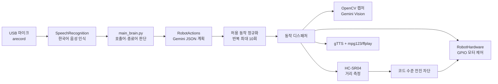

# 아키텍처

[English](../architecture.md) | [한국어](architecture.md) | [日本語](../ja/architecture.md)

이 문서는 2026년 5월 28일 최종 통합본을 기준으로, 현재 공개 코드에서 실제로 이어지는 호출 경로를 설명합니다. 7월 9일 처음 공개된 축약본과의 차이는 [프로젝트 제작·복원 기록](project-story.md)에 따로 정리했습니다.

## 전체 실행 흐름



## 1. `main_brain.py`: 음성 명령 루프

프로그램은 `.env`를 먼저 읽은 뒤 `RobotHardware`와 `RobotActions`를 생성합니다. 이후 다음 순서로 반복합니다.

1. 마이크에서 한국어 음성을 듣습니다.
2. `명령 시작` 계열 호출어를 확인합니다.
3. 명령을 다시 듣고, 인식 실패 시 두 번까지 재시도합니다.
4. 인식된 문장을 `RobotActions.run_command()`에 전달합니다.
5. `종료`, `꺼져`, `끝내`, `그만` 계열 명령이면 정리 후 종료합니다.

`main_brain.py`는 이미지나 GPIO를 직접 다루지 않습니다. 장치 접근은 `hardware.py`, 판단과 실행 순서는 `actions.py`로 나뉩니다.

## 2. `actions.py`: JSON 계획과 허용 목록 디스패치

현재 구현은 Python 함수를 Gemini SDK에 직접 넘기는 자동 function calling 방식이 아닙니다. Gemini에 명령 분류 규칙을 전달하고 다음과 같은 JSON 계획만 받습니다.

```json
{
  "steps": [
    {"action": "MOVE_FORWARD", "repeat": 1, "object_name": ""}
  ]
}
```

응답은 코드 블록 표식을 제거한 뒤 `json.loads`로 파싱합니다. 이후 허용된 행동명과 반복 횟수를 정규화하고, 반복은 최대 10회로 제한합니다. 모델 호출이나 JSON 파싱이 실패하면 규칙 기반 명령 판별로 대체합니다.

대표 행동은 전진·후진·좌우 회전·정지·장애물까지 전진·거리 질문·장면 질문·물체 접근·음성 답변입니다. 문자열을 `eval`하거나 모델이 만든 임의 Python 코드를 실행하지 않습니다.

## 3. `hardware.py`: 장치 계층

`hardware.py`는 현재 주 실행 경로에 연결되어 있습니다. `RobotHardware`가 다음 기능을 제공합니다.

| 기능 | 현재 구현 |
| --- | --- |
| 모터 | BCM GPIO 5, 6, 16, 26으로 좌우 모터 방향 제어 |
| 거리 | HC-SR04 TRIG 23, ECHO 24, 중앙값 기반 측정 |
| 상태 LED | BCM GPIO 25 |
| 카메라 | OpenCV `VideoCapture`, 기본 index 1, 640×480 JPEG |
| 음성 입력 | `arecord` raw stream + Google 한국어 음성 인식 |
| 음성 출력 | gTTS 캐시 + `mpg123`, 대체 경로 `ffplay` |

`RPi.GPIO`를 불러오지 못하면 테스트 모드 메시지를 출력하지만, 카메라·오디오·네트워크 기능까지 자동으로 모킹되는 것은 아닙니다.

## Gemini Vision 흐름

장면 질문, 조건부 시각 판단, 물체 접근 시 `capture_image()`로 JPEG를 저장하고 Gemini에 이미지와 질문을 보냅니다. 물체 접근은 최대 7번까지 다음 과정을 반복합니다.

1. 초음파 거리가 목표 정지 거리 이하인지 확인합니다.
2. 이미지를 촬영합니다.
3. Gemini Vision에 물체의 위치와 보정 방향을 JSON으로 요청합니다.
4. 좌우 정렬 또는 짧은 전진을 실행합니다.

매 단계마다 네트워크 왕복과 이미지 분석이 들어가므로 반응이 느릴 수 있습니다. 카메라 인식 결과만으로 안전을 보장하지 않습니다.

## 안전 경계

안전 조건은 프롬프트만이 아니라 장치 계층에도 일부 구현되어 있습니다.

- `move_forward()`는 실행 직전에 새 거리 값을 읽고 기본 25cm 이하이면 전진을 거부합니다.
- `move_forward_until_obstacle()`은 주행 중 거리를 반복 측정해 기본 18cm 이하에서 정지합니다.
- 물체 접근은 각 단계 전에 초음파 거리를 다시 확인합니다.
- ECHO가 처음부터 HIGH로 고정되거나 측정 예외가 발생하면 0cm로 처리해 정지합니다.
- 종료 시 모터 정지, 카메라 해제, GPIO cleanup을 시도합니다.

하지만 완전한 안전 시스템은 아닙니다.

- ECHO 상승을 기다리다 타임아웃이 발생한 경우 기본 최대 거리 400cm로 처리합니다.
- 후방·측면 센서가 없고, 물리 긴급 정지 버튼도 코드에 포함되어 있지 않습니다.
- 고정 시간 모터 제어라 바닥, 배터리 전압, 하중에 따라 실제 이동량이 달라집니다.
- 모델의 시각 판단과 음성 인식은 틀릴 수 있습니다.
- 규칙 기반 대체 분류기는 복합 문장의 행동 순서와 대상을 정확히 분해하지 못할 수 있습니다.

따라서 바퀴를 띄운 시험, 낮은 속도, 충분한 공간, 즉시 끌 수 있는 모터 전원이 필요합니다.

## 보조 파일

- `test_case.py`: 실제 장치 메서드를 호출하지 않고 명령 계획 결과만 확인합니다. API 키가 없으면 규칙 기반 대체 경로를 사용합니다.
- `2main_brain.py`: 이전 SDK와 지금은 없는 `robot` 객체를 사용하는 역사적 실험 파일입니다. 현재 진입점이 아니며 그대로 실행할 수 없습니다.

## 향후 권장 개선

아래 항목은 현재 구현이 아니라 다음 단계입니다.

- 센서 타임아웃도 실패 정지로 통일하고 오류 상태를 별도로 반환하기
- 허용 동작별 지속시간·횟수의 상한을 구성 파일과 테스트로 고정하기
- 모터 제어와 센서 계층에 가상 구현을 두어 하드웨어 없는 단위 테스트 추가하기
- 물리 긴급 정지, 후방·측면 센서, 배터리 전압 감시 추가하기
- 오디오·카메라·Gemini 지연을 계측하고 비동기 처리 또는 로컬 모델 검토하기
- `2main_brain.py`를 별도 보관 경로로 옮기거나 제거하기
