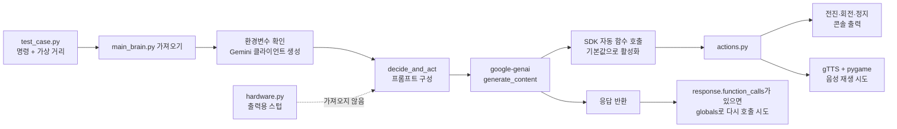
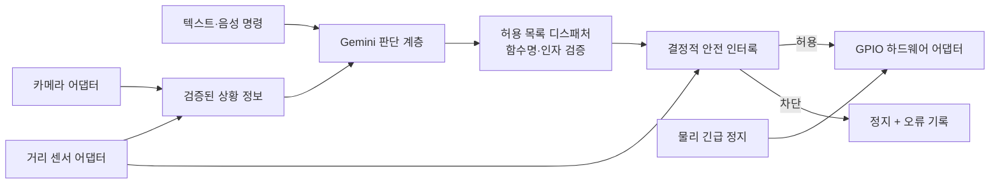

# 아키텍처

[English](../architecture.md) | [한국어](architecture.md)

이 문서는 현재 공개된 Python 코드에서 실제로 이어지는 호출 경로와, 실물 하드웨어를 다시 연결할 때 권장하는 구조를 구분해 설명합니다. 아래의 ‘현재 구조’는 코드에서 확인한 사실이고, 마지막의 ‘향후 권장 구조’는 아직 구현되지 않은 설계 제안입니다.

## 현재 공개 코드의 실제 호출 흐름



### 1. 모듈을 가져오는 시점

`test_case.py`는 `main_brain.py`에서 `decide_and_act`를 가져옵니다. 이때 `main_brain.py`의 최상위 코드가 실행되어 다음 작업이 먼저 일어납니다.

1. `.env`가 있으면 `python-dotenv`로 읽습니다.
2. `GOOGLE_API_KEY`가 없으면 즉시 `RuntimeError`를 발생시킵니다.
3. `genai.Client`를 생성합니다.
4. `move_forward`, `spin_around`, `stop_moving`, `speak`를 도구 목록에 넣습니다.

따라서 API 키가 없으면 테스트 시나리오가 시작되기 전에 종료됩니다.

### 2. 테스트 입력

`test_case.py`는 마이크나 센서를 사용하지 않습니다. 코드에 적힌 세 개의 명령 문자열과 `100.0`, `15.0`, `50.0`이라는 거리 숫자를 차례로 `decide_and_act`에 전달합니다.

### 3. Gemini 요청

`decide_and_act`는 사용자 명령, 전달받은 거리, ‘20cm 이내라면 앞으로 가지 말라’는 지시를 하나의 프롬프트로 만듭니다. 이 값은 실제 센서에서 읽은 값이 아니라 호출자가 준 숫자입니다.

`GenerateContentConfig.tools`에는 함수 선언 객체가 아니라 Python 함수 자체가 전달됩니다. 현재 [Google Gen AI Python SDK 문서](https://googleapis.github.io/python-genai/) 기준으로 이 방식은 자동 함수 호출이 기본 활성화됩니다. 코드에서 `automatic_function_calling.disable=True`를 지정하지 않았으므로 SDK가 `generate_content` 내부에서 함수를 호출하고 그 결과를 다시 모델에 전달할 수 있습니다.

그 뒤 코드에는 `response.function_calls`를 순회하여 `globals()[function_name](**args)`를 호출하는 수동 경로도 있습니다. 설치되는 `google-genai` 버전과 응답 형태에 따라 이 분기가 실제로 사용되는지는 달라질 수 있습니다. `requirements.txt`가 최소 버전만 지정하고 상한이나 고정 버전을 두지 않는다는 점도 재현성에 영향을 줍니다.

### 4. 동작 함수

| 함수 | 현재 실제 동작 |
| --- | --- |
| `move_forward(duration)` | 이동하지 않고 요청 시간과 전진 메시지를 출력 |
| `spin_around()` | 회전하지 않고 회전 메시지를 출력 |
| `stop_moving()` | 모터를 멈추지 않고 정지 메시지를 출력 |
| `speak(text)` | gTTS로 `speech.mp3`를 만들고 pygame으로 재생을 시도 |

`speak`는 예외를 잡아 메시지만 출력하므로 네트워크나 오디오 장치 문제가 있어도 예외가 호출자까지 다시 전달되지 않습니다.

## main_brain.py → Gemini → actions.py 관계

`main_brain.py`가 모델에 노출하는 도구는 `actions.py`에서 직접 가져온 네 함수입니다. `hardware.py`의 같은 이름 함수는 가져오지 않습니다. 따라서 현재 주 실행 경로는 다음처럼 끝납니다.

```text
test_case.py
  → main_brain.decide_and_act(command, distance)
    → Gemini API
      → actions.py의 함수
        → 콘솔 출력 또는 음성 재생 시도
```

현재 경로에는 GPIO, 모터 드라이버, HC-SR04, 카메라 또는 마이크 모듈이 없습니다.

## hardware.py의 현재 위치

`hardware.py`에는 전진, 회전, 정지, 말하기 함수가 있지만 모두 출력용 스텁입니다. `main_brain.py`, `actions.py`, `test_case.py` 중 어느 파일도 `hardware.py`를 가져오지 않으므로 실행 경로와 분리되어 있습니다.

향후 `hardware.py`를 실제 장치 계층으로 사용할 수는 있지만, 현재 문서에서는 연결되어 있다고 표현하지 않습니다.

## 프롬프트 안전 조건과 코드 수준 안전장치

| 구분 | 프롬프트 지시 | 코드 수준 안전장치 |
| --- | --- | --- |
| 실행 주체 | Gemini 모델의 판단 | 애플리케이션의 결정적 조건문 |
| 현재 20cm 조건 | 있음 | 없음 |
| 모델이 전진을 선택할 가능성 | 남아 있음 | 구현하면 강제로 차단 가능 |
| API 오류·비정상 응답 대응 | 보장하지 않음 | 안전한 기본 동작을 강제할 수 있음 |
| 실제 모터 사용 적합성 | 부적합 | 별도 구현과 검증이 필요 |

현재 코드는 `distance <= 20`을 검사한 뒤 `move_forward`를 거부하는 조건문이 없습니다. 프롬프트는 모델 행동을 유도할 뿐 안전을 보장하지 않으므로, 실물 모터 제어에 사용해서는 안 됩니다.

## 2main_brain.py 상태

`2main_brain.py`는 이전 `google-generativeai` SDK를 사용한 실험 흔적입니다. 현재 `actions.py`에 존재하지 않는 `robot` 객체를 가져오며 `move_backward`도 도구 목록에 넣습니다. 또한 `robot.listen_command`, `robot.get_distance_cm`, `robot.wheels`, `robot.camera`를 사용합니다. 필요한 구현이 저장소에 없으므로 현재 상태에서는 실행할 수 없습니다.

## 향후 권장 구조

아래는 **현재 구현이 아니라 향후 권장 설계**입니다.



권장 분리 기준은 다음과 같습니다.

- Gemini는 행동 후보만 제안합니다.
- 디스패처는 허용된 함수명과 인자 형식·범위를 검사합니다.
- 안전 인터록은 모델 응답과 무관하게 최신 센서 값, 이동 시간, 속도, 정지 상태를 검사합니다.
- 하드웨어 계층은 실제 GPIO 구현과 테스트용 가상 구현을 같은 인터페이스 뒤에 둡니다.
- API 오류, 센서 오류, 장치 오류가 발생하면 기본 동작은 정지여야 합니다.
- 실제 API 없이 실행되는 모킹 테스트와 안전 조건 단위 테스트를 별도로 둡니다.
