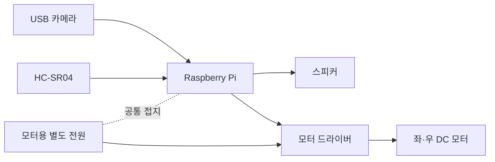

# 배선 가이드

[English](../wiring.md) | [한국어](wiring.md)

이 문서는 향후 실제 하드웨어 계층을 구현할 때 참고할 수 있는 개념 배선과 안전 원칙을 설명합니다. 현재 공개 Python 코드에는 GPIO 설정이나 아래 핀을 사용하는 코드가 없습니다. 표의 번호를 실물 프로토타입에서 실제 사용한 핀이라고 해석하지 마세요.

## 배선 개념도

Raspberry Pi는 모터 전력을 공급하는 장치가 아니라 모터 드라이버에 논리 제어 신호를 보내는 제어기 역할을 맡아야 합니다. 모터의 전류 요구량에 맞는 별도 전원과 드라이버를 사용합니다.

## GPIO 예시

아래는 문서화를 위한 BCM GPIO 번호 예시입니다. Raspberry Pi의 물리 핀 번호와 BCM 번호는 다르므로 혼동하지 않습니다. 사용하는 모터 드라이버, PWM 방식, 이미 활성화된 인터페이스, 실제 차체 배선에 맞게 다시 설계해야 합니다.

| 구성 요소 | BCM GPIO 예시 | 용도 |
| --- | ---: | --- |
| 왼쪽 모터 IN1 | 17 | 방향 제어 |
| 왼쪽 모터 IN2 | 27 | 방향 제어 |
| 오른쪽 모터 IN1 | 22 | 방향 제어 |
| 오른쪽 모터 IN2 | 23 | 방향 제어 |
| 모터 PWM A | 18 | 왼쪽 속도 제어 |
| 모터 PWM B | 13 | 오른쪽 속도 제어 |
| HC-SR04 TRIG | 5 | 거리 측정 시작 출력 |
| HC-SR04 ECHO | 6 | 전압 변환을 거친 입력 |
| 접지 | GND | 제어 신호 기준 전위 공유 |

이 저장소에는 위 번호를 설정하는 코드가 없습니다. 새 하드웨어 구현을 추가할 때 핀 번호를 한 곳의 설정으로 모으고, 시작과 종료 시 GPIO 상태를 안전하게 초기화·정리하는 것이 좋습니다.

## 모터 별도 전원

- DC 모터를 Raspberry Pi의 5V 핀에서 직접 구동하지 않습니다.
- 모터 전압과 순간 전류를 감당할 수 있는 배터리 또는 전원 공급 장치를 사용합니다.
- 모터 드라이버의 정격 전압·전류와 방열 조건을 확인합니다.
- 배터리 역극성, 과전류, 단락을 막을 수 있는 보호 수단을 준비합니다.
- 모터 전원에는 손으로 즉시 끌 수 있는 물리 스위치를 두는 것이 좋습니다.

## 공통 접지

Raspberry Pi의 제어 신호와 모터 드라이버가 같은 기준 전위를 사용하도록 회로 설계에 맞게 GND를 연결합니다. 공통 접지가 없으면 방향 신호나 PWM이 불안정하게 해석될 수 있습니다.

모터 전원과 Raspberry Pi 전원을 임의로 병렬 연결한다는 의미는 아닙니다. 전원 입력과 접지 구성은 사용 중인 드라이버의 데이터시트를 기준으로 확인합니다.

## HC-SR04 ECHO 5V 처리

일반적인 HC-SR04의 ECHO 출력은 5V 수준일 수 있고 Raspberry Pi GPIO는 3.3V 논리를 사용합니다. ECHO를 GPIO에 직접 연결하지 말고 적절한 저항 분압기 또는 로직 레벨 시프터로 전압을 낮춥니다.

- TRIG는 Raspberry Pi 출력에서 센서 입력으로 연결합니다.
- ECHO는 전압 변환 회로를 거쳐 Raspberry Pi 입력으로 연결합니다.
- 구현 코드에는 응답 타임아웃과 비정상 거리 값 처리가 필요합니다.
- 센서 값 하나만 믿고 모터를 계속 구동하지 않도록 최근 값, 오류 상태와 정지 정책을 함께 설계합니다.

## 카메라와 오디오

USB 카메라와 USB 오디오 장치는 GPIO 배선보다 운영체제의 장치 인식과 권한 설정이 중요합니다. 현재 공개 코드에는 카메라 입력이나 마이크 입력이 없고, 스피커 출력만 gTTS·pygame 경로가 있습니다.

카메라를 추가할 경우 프레임에 사람, 문서, 주소, 화면 또는 위치 정보가 포함될 수 있으므로 저장과 전송 범위를 먼저 정합니다.

## 최초 테스트 안전 절차

1. 전원을 연결하지 않은 상태에서 배선과 극성을 다시 확인합니다.
2. 멀티미터로 예상 전압을 확인하고 Raspberry Pi GPIO에 5V가 들어가지 않는지 점검합니다.
3. 모델이나 네트워크 없이 정지 함수와 물리 전원 차단부터 검증합니다.
4. 차체 바퀴를 바닥에서 띄웁니다.
5. 한쪽 모터를 짧은 시간과 낮은 속도로 시험합니다.
6. 좌우 방향과 정지 동작을 각각 확인합니다.
7. 센서 오류와 타임아웃 상황에서 무조건 정지하는지 확인합니다.
8. 코드 수준 거리 인터록을 별도로 시험합니다.
9. 주변에 사람과 장애물이 없는 넓은 공간에서 낮은 속도로 바닥 주행을 시작합니다.
10. 시험 중에는 모터 전원 스위치에 바로 손이 닿도록 합니다.

현재 저장소는 3단계 이후에 필요한 실제 모터·센서 코드를 제공하지 않습니다. 하드웨어 구현과 검증 없이 Gemini 응답을 모터에 연결하지 마세요.
