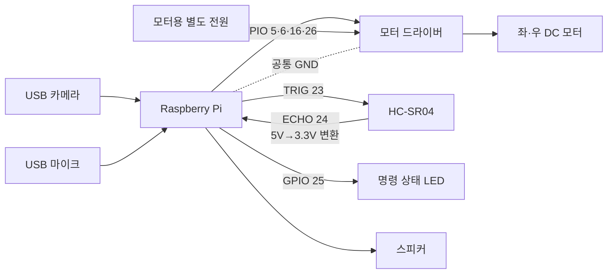

# 배선 가이드

[English](../wiring.md) | [한국어](wiring.md)

이 문서는 현재 `hardware.py`의 BCM 핀 설정을 기준으로 합니다. 실제 차체에 다시 연결할 때는 모터 드라이버 데이터시트와 Raspberry Pi 핀맵을 함께 확인하세요.

## 배선 개념도

## 현재 코드의 BCM 핀

| 구성 요소 | BCM GPIO | 코드 상 역할 |
| --- | ---: | --- |
| 모터 IN1 | 5 | 왼쪽 모터 방향 |
| 모터 IN2 | 6 | 왼쪽 모터 방향 |
| 모터 IN3 | 16 | 오른쪽 모터 방향 |
| 모터 IN4 | 26 | 오른쪽 모터 방향 |
| HC-SR04 TRIG | 23 | 초음파 송신 시작 출력 |
| HC-SR04 ECHO | 24 | 전압 변환을 거친 거리 입력 |
| 명령 LED | 25 | 명령 수신 상태 표시 |

표는 BCM 번호입니다. 보드의 물리 핀 번호와 다릅니다. 초음파·LED 핀은 `.env`로 바꿀 수 있지만 네 모터 핀은 현재 `hardware.py` 상수이므로 변경 시 코드도 수정해야 합니다.

## 모터 전원과 공통 접지

- DC 모터를 Raspberry Pi의 5V 핀에서 직접 구동하지 않습니다.
- 모터 정격과 순간 전류를 감당하는 별도 배터리와 모터 드라이버를 사용합니다.
- Raspberry Pi GND와 드라이버의 논리 GND를 연결해 제어 신호 기준을 공유합니다.
- 전원 입력을 임의로 병렬 연결하지 말고 드라이버 데이터시트를 따릅니다.
- 배터리 역극성·과전류·단락 보호와 손으로 즉시 끌 수 있는 스위치를 둡니다.

배터리 전압이 낮거나 모터가 부하를 받으면 코드가 같아도 회전량과 직진성이 달라질 수 있습니다. 이 프로젝트에서도 배터리 전압이 실물 동작에 큰 변수였습니다.

## HC-SR04 ECHO 전압

일반적인 HC-SR04의 ECHO는 5V 수준이고 Raspberry Pi GPIO는 3.3V 입력입니다. ECHO를 GPIO24에 직접 연결하지 말고 저항 분압기나 로직 레벨 시프터를 거칩니다.

- TRIG: Raspberry Pi GPIO23 → 센서 TRIG
- ECHO: 센서 ECHO → 전압 변환 → Raspberry Pi GPIO24
- VCC와 GND: 사용 센서와 보드의 사양에 맞게 연결

현재 코드는 측정값 3개의 중앙값을 사용합니다. ECHO 고정 HIGH나 예외는 0cm로 처리하지만, ECHO 상승 타임아웃은 최대 거리로 처리하므로 센서 하나만으로 완전한 충돌 방지를 기대하면 안 됩니다.

## USB 카메라와 오디오

카메라와 마이크는 GPIO가 아니라 USB 장치 번호에 영향을 받습니다.

- 기본 카메라 index는 `1`입니다.
- 기본 마이크 장치는 `plughw:3,0`입니다.
- USB 연결 순서나 재부팅으로 번호가 바뀔 수 있으므로 `CAMERA_INDEX`, `AUDIO_DEVICE`를 현장에서 확인합니다.

카메라가 촬영한 JPEG가 Gemini에 전송될 수 있습니다. 사람, 문서, 주소나 사적인 공간을 촬영하지 않도록 범위를 제한하세요.

## 최초 테스트 안전 절차

1. 모든 전원을 뺀 상태에서 BCM 번호, 극성과 단락을 확인합니다.
2. ECHO 전압 변환과 공통 접지를 확인합니다.
3. 모터 전원을 분리한 채 센서 거리만 출력해 봅니다.
4. 바퀴를 바닥에서 띄우고 한쪽 모터씩 아주 짧게 시험합니다.
5. 좌우·전후진·정지를 각각 확인합니다.
6. 25cm 이하 단발 전진 차단을 확인합니다.
7. 18cm 연속 주행 정지와 센서 오류 상황을 확인합니다.
8. 카메라와 음성 명령을 추가합니다.
9. 주변에 사람과 장애물이 없는 넓은 공간에서 짧게 주행합니다.
10. 시험 중 모터 전원 스위치에 손이 닿는 위치를 유지합니다.
