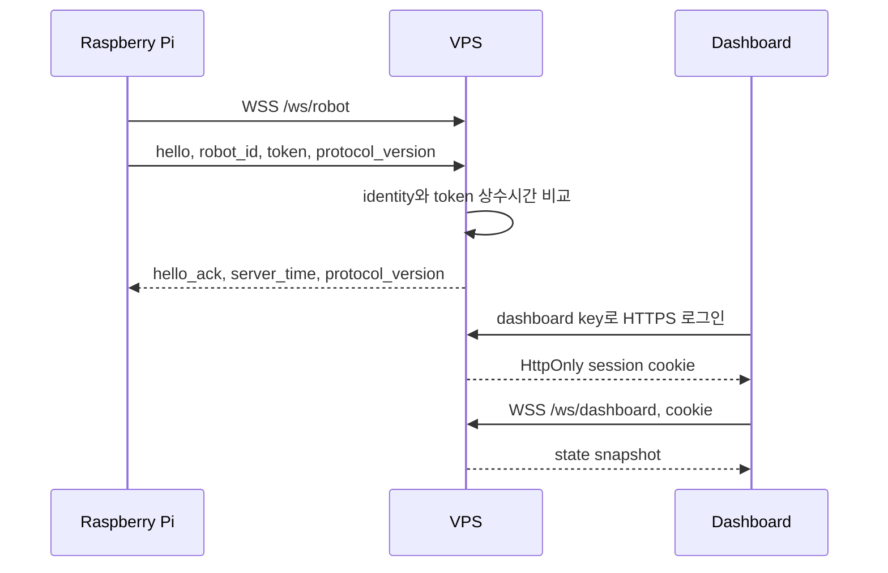

# 로봇 통신 프로토콜

Raspberry Pi와 VPS는 하나의 장기 WebSocket 연결을 사용합니다. 제어와 상태 메시지는 UTF-8 JSON으로, 카메라 프레임은 `RBT1` 바이너리 프레임으로 전송합니다.

공통 구현은 `packages/robot-protocol`의 `robot_protocol` 패키지에 있습니다. 런타임 외부 의존성은 없습니다.

## 버전

| 항목 | 값 |
|---|---|
| 프로토콜 이름 | `rpi-robot-control` |
| 현재 버전 | `1` |
| 바이너리 매직 | `RBT1` |

새 클라이언트는 첫 hello에 `protocol_version`을 포함합니다. 구조 전환 전 클라이언트와의 순차 배포를 위해 버전 필드가 없는 hello는 버전 1로 취급할 수 있습니다. 호환되지 않는 major 버전은 WebSocket policy violation으로 거부해야 합니다.

VPS의 `hello_ack`도 같은 `protocol_version`을 반환합니다. Pi는 `HelloAckMessage`로 응답 type, 서버 시간과 지원 버전을 검증한 뒤에만 연결 완료 상태로 전환합니다. 전환 기간에는 version이 없는 기존 `hello_ack`도 버전 1로 해석합니다.

## 연결과 인증



예시의 값은 형식 설명을 위한 것이며 실제 비밀값을 문서나 로그에 남기지 않습니다.

```json
{
  "type": "hello",
  "robot_id": "robot-01",
  "token": "replace-with-runtime-secret",
  "protocol_version": 1
}
```

VPS 응답은 다음 형태입니다.

```json
{
  "type": "hello_ack",
  "server_time": 1788275415.78,
  "protocol_version": 1
}
```

## 메시지 방향

| type | 방향 | 목적 |
|---|---|---|
| `hello` | Pi에서 VPS | 로봇 식별과 인증 |
| `hello_ack` | VPS에서 Pi | 인증 성공과 서버 시간 전달 |
| `command` | VPS에서 Pi | 주행, 촬영, 영상과 자연어 명령 |
| `telemetry` | Pi에서 VPS | 모드, 동작, 거리와 하드웨어 상태 |
| `status` | Pi에서 VPS | 정지, 영상 종료와 연결 상태 이벤트 |
| `command_result` | Pi에서 VPS | 명령 수락, 완료, 거절 또는 실패 결과 |
| `camera` | Pi에서 VPS | 사진 또는 영상 JPEG 메타데이터와 bytes |
| `speech` | Pi에서 VPS | 로봇 발화 자막과 선택적 오디오 |
| `state` | VPS에서 대시보드 | 최신 로봇 상태 snapshot |
| `event` | VPS에서 대시보드 | 기록 가능한 상태와 명령 결과 |

카메라 bytes는 VPS가 대시보드 WebSocket에 raw JPEG binary로 다시 보냅니다. `speech`의 오디오는 현재 JSON Base64이며 2MB 이하만 중계합니다.

## 명령

```json
{
  "type": "command",
  "id": "64fcda35-7f56-4a83-88d2-3fac2bf8e918",
  "action": "FORWARD",
  "text": "",
  "duration_ms": 650,
  "created_at": "2026-09-02T00:00:00+00:00",
  "expires_at": "2026-09-02T00:00:02+00:00"
}
```

| action | 의미 | 추가 조건 |
|---|---|---|
| `FORWARD` | 전진 lease 갱신 | 거리 센서가 안전해야 함 |
| `BACKWARD` | 후진 lease 갱신 | Pi가 최대 1000ms로 제한 |
| `LEFT` | 좌회전 lease 갱신 | Pi가 최대 1000ms로 제한 |
| `RIGHT` | 우회전 lease 갱신 | Pi가 최대 1000ms로 제한 |
| `STOP` | 즉시 모터 정지 | 다른 동작보다 우선 처리 |
| `TEXT_COMMAND` | 자연어 행동 요청 | 빈 `text` 거부 |
| `GET_DISTANCE` | 거리 측정 요청 | 센서 실패 시 실패 결과 |
| `CAPTURE_IMAGE` | 사진 한 장 요청 | JPEG 2MB 이하 |
| `VIDEO_START` | 영상 lease 시작 또는 갱신 | 최대 10초 요청 값 허용 |
| `VIDEO_STOP` | 영상 전송 중단 | 카메라 리소스 해제 |

프로토콜 수준의 `duration_ms` 범위는 100ms부터 10000ms입니다. 실제 주행은 Pi가 1000ms 이하로 다시 제한합니다. 주행 명령의 `expires_at`은 짧게 설정하며, Pi는 이미 만료된 명령을 실행하지 않습니다.

## 명령 결과

```json
{
  "type": "command_result",
  "robot_id": "robot-01",
  "command_id": "64fcda35-7f56-4a83-88d2-3fac2bf8e918",
  "status": "rejected",
  "reason": "obstacle_detected",
  "distance_cm": 14.2,
  "timestamp": 1788275415.78
}
```

`status`는 현재 `accepted`, `completed`, `rejected`, `failed` 중 하나를 사용합니다. `reason`은 기계가 처리할 수 있는 짧은 문자열이며 사용자용 문구와 분리합니다.

## 텔레메트리

텔레메트리는 약 1초 간격의 최신 상태 snapshot입니다. 일부 하드웨어가 비활성화되면 관련 필드는 없거나 `null`일 수 있습니다.

```json
{
  "type": "telemetry",
  "robot_id": "robot-01",
  "mode": "REMOTE",
  "motion": "FORWARD",
  "distance_cm": 120.0,
  "obstacle": false,
  "remote_control_active": true,
  "video_active": true,
  "hardware_health": {
    "gpio_ready": true,
    "camera_ok": true,
    "audio_input_ok": true,
    "audio_output_ok": true,
    "ultrasonic_enabled": true
  },
  "timestamp": 1788275415.78
}
```

GNSS가 활성화되면 `location`이 포함될 수 있지만 현재 대시보드는 이 필드를 표시하지 않습니다.

## RBT1 바이너리 프레임

```text
0               4               8                         N
+---------------+---------------+-------------------------+
| MAGIC "RBT1"  | metadata size | UTF-8 JSON metadata     |
| 4 bytes       | uint32, BE    | metadata size bytes     |
+---------------+---------------+-------------------------+
| binary payload, remaining bytes                         |
+---------------------------------------------------------+
```

| 제한 | 값 |
|---|---:|
| 메타데이터 최대 크기 | 16384 bytes |
| 프로토콜 payload 최대 크기 | 2500000 bytes |
| 서버가 허용하는 카메라 이미지 | 2000000 bytes |

카메라 메타데이터 예시는 다음과 같습니다.

```json
{
  "type": "camera",
  "content_type": "image/jpeg",
  "stream": true,
  "timestamp": 1788275415.78
}
```

decoder는 다음 조건을 모두 확인한 뒤 payload를 사용합니다.

1. 최소 헤더 길이
2. `RBT1` 매직 값
3. metadata 길이 범위
4. JSON 객체 여부
5. payload 존재 여부와 최대 크기

## 전송 순서와 유실 정책

- `status`와 `command_result`는 우선 큐를 사용합니다.
- 영상 frame은 아직 보내지 않은 이전 frame을 교체할 수 있습니다.
- telemetry도 아직 보내지 않은 이전 snapshot을 교체할 수 있습니다.
- WebSocket send가 제한시간을 넘기면 연결을 실패 처리하고 재연결합니다.
- 명령은 queue 유실에 의존하지 않고 고유 ID, 만료시간과 실행 결과로 추적합니다.

이 정책은 모든 frame을 전달하는 것보다 현재 화면을 빠르게 보여주는 데 초점을 둡니다.

## 호환성 변경 절차

1. 공통 패키지에서 새 필드를 optional로 추가합니다.
2. 이전 Pi를 허용하는 VPS를 먼저 배포합니다.
3. 새 필드를 전송하는 Pi를 배포합니다.
4. 양쪽 운영 버전이 확인된 뒤 deprecated 형식을 제거합니다.
5. 호환되지 않는 변경은 `PROTOCOL_VERSION`을 올리고 ADR에 기록합니다.

VPS와 Pi를 동시에 교체할 수 없는 원격 배포 특성 때문에 엄격한 필드 제거보다 단계적 전환을 우선합니다.
