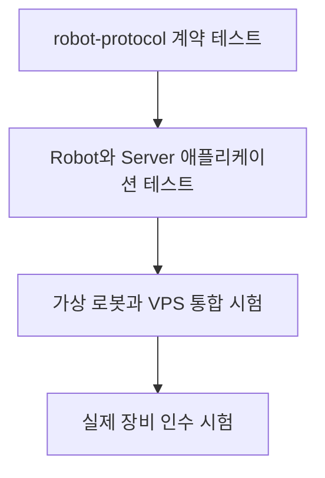

# 테스트 전략

테스트는 공통 통신 계약, Raspberry Pi 애플리케이션, VPS 서버와 실제 하드웨어를 분리합니다. 자동 테스트가 통과해도 모터와 센서의 물리 검증이 끝났다는 뜻은 아닙니다.

## 테스트 피라미드



| 계층 | 확인 내용 | 외부 장치 |
|---|---|---|
| 공통 계약 | action, 메시지, 버전과 RBT1 frame | 없음 |
| Robot 단위 테스트 | 명령 중재, lease, 안전정지, queue와 설정 | 테스트 더블 |
| Server 단위 테스트 | 인증, session, REST, WebSocket와 event 처리 | 없음 |
| 통합 테스트 | 가상 로봇 연결, 명령 왕복, 영상과 발화 | 선택 |
| 하드웨어 인수 시험 | GPIO, 거리 센서, 네 방향, 카메라와 오디오 | 실제 Pi |

## 공통 프로토콜

공통 패키지는 표준 라이브러리 `unittest`만으로 검증할 수 있습니다.

```bash
cd /path/to/robot-pj
PYTHONPATH=packages/robot-protocol/src \
  python -m unittest discover -s packages/robot-protocol/tests -v
```

검증 항목은 다음과 같습니다.

- 모든 `Action` 값과 허용 명령 집합의 일치
- command, hello와 hello_ack parse 및 직렬화
- 토큰이 객체 표현에 노출되지 않음
- protocol version 호환성
- RBT1 frame 왕복
- 잘못된 magic, metadata 크기와 빈 payload 거부

공통 패키지는 action, 메시지 버전과 RBT1 frame을 로컬 테스트로 검증합니다.

## Raspberry Pi 애플리케이션

```bash
cd /path/to/robot-pj
python3 -m venv robot/.venv
robot/.venv/bin/python -m pip install -e ./packages/robot-protocol -e './robot[dev]'
cd robot
.venv/bin/python -m pytest
```

하드웨어 없는 환경에서는 GPIO를 test double로 바꾸고 다음 규칙을 확인합니다.

- 만료된 원격 명령을 실행하지 않음
- 전진 전 거리 확인과 장애물 거절
- 연결 해제와 lease 만료 시 모터 정지
- STOP과 상태 이벤트의 우선 처리
- 카메라와 telemetry의 최신 항목 coalescing
- WebSocket send timeout 이후 재연결
- 초음파 비활성 상태의 Pi fail-safe
- Gemini 요청 timeout 설정

Windows에서 테스트할 때는 Linux 전용 GPIO dependency가 설치되지 않아야 하며, 테스트가 실제 GPIO를 호출해서도 안 됩니다.

## VPS 애플리케이션

```bash
cd /path/to/robot-pj/server
python3 -m venv .venv
.venv/bin/python -m pip install -r requirements-dev.txt
.venv/bin/python -m pytest
```

FastAPI TestClient와 WebSocket client로 다음 경계를 검증합니다.

- dashboard key 로그인과 잘못된 key 거절
- HttpOnly session 발급, 조회와 로그아웃
- 인증 전 API와 WebSocket 접근 거절
- robot token과 robot ID 검증
- 허용 action만 command로 변환
- robot offline 상태에서 명령 거절
- telemetry의 최신 상태 반영
- JPEG binary frame 수신과 dashboard fan-out
- speech 자막과 허용된 audio type 전달
- 연결 종료 시 online, motion과 video 상태 초기화
- 이벤트 로그에 비밀값을 쓰지 않음

## 프론트 정적 검사

모든 JavaScript 파일의 구문을 확인합니다.

```bash
cd /path/to/robot-pj
find server/server/static -name '*.js' -print0 | xargs -0 -n1 node --check
```

각 패키지 테스트와 JavaScript 검사는 위 로컬 명령으로 확인합니다.

브라우저 수동 검증은 다음 순서를 사용합니다.

1. 로그인 전 VPS와 Pi 연결 상태가 구분되는지 확인합니다.
2. 올바른 key로 로그인하고 dashboard WebSocket이 한 번만 연결되는지 확인합니다.
3. 로봇 online 상태에서 영상이 자동 시작되는지 확인합니다.
4. Pi 연결을 끊고 마지막 frame이 즉시 사라지는지 확인합니다.
5. 재연결 후 중복 WebSocket이나 중복 명령이 생기지 않는지 확인합니다.
6. 로봇 발화가 자막과 소리로 함께 표시되는지 확인합니다.

## 가상 로봇 통합 시험

실제 모터 없이 서버부터 브라우저까지 확인할 때 사용합니다.

```bash
# terminal 1
cd /path/to/robot-pj/server
.venv/bin/uvicorn server.app:app --host 127.0.0.1 --port 8000 --workers 1

# terminal 2
cd /path/to/robot-pj/server
.venv/bin/python tools/fake_robot.py
```

가상 로봇은 테스트 전용 token을 사용하며 운영 token을 소스나 shell history에 남기지 않습니다.

## 실제 하드웨어 인수 시험

물리 시험은 [하드웨어 문서](hardware.md)의 안전 조건을 충족한 뒤 순서대로 진행합니다.

| 시험 | 통과 조건 |
|---|---|
| GPIO 초기화와 정리 | 시작 시 출력 LOW, 종료 후 IN1부터 IN4 모두 LOW |
| HC-SR04 | 알려진 거리에서 여러 번 유효한 값, timeout 시 전진 차단 |
| 전진 | 바퀴를 띄운 상태에서 예상 방향으로 한 번 동작 |
| 후진 | 바퀴를 띄운 상태에서 예상 방향으로 한 번 동작 |
| 좌회전과 우회전 | 방향 mapping과 실제 회전이 일치 |
| 카메라 | `/dev/video0`에서 컬러 JPEG 획득 |
| 마이크 | 이름 기반 ALSA 장치에서 3초 녹음 |
| 스피커 | 사용자 승인 후 녹음 파일 한 번 재생 |
| 원격 주행 | 입력 유지 중만 움직이고 release, background, disconnect에서 정지 |

## 현재 검증 범위

운영 인수인계 기록에서 확인된 내용은 다음과 같습니다.

- USB 카메라 사진 촬영 성공
- USB 마이크 3초 녹음 성공
- 사용자 승인 후 USB 스피커 재생 성공
- VPS 연결 중 `robot_online=true` 확인
- 기존 mapping에서 짧은 모터 동작 한 번 수행 후 GPIO LOW 정리

아직 완료 증거가 부족한 항목은 다음과 같습니다.

- HC-SR04의 안정적인 다회 측정
- 교정된 mapping의 네 방향 실제 확인
- 브라우저에서 STOP과 네 방향 원격 주행
- 실제 카메라 장시간 스트림 지연 측정
- 음성 호출어와 명령의 반복 인식률 측정

이 구분을 유지해 자동 테스트 결과를 실제 하드웨어 검증 결과처럼 표현하지 않습니다.
