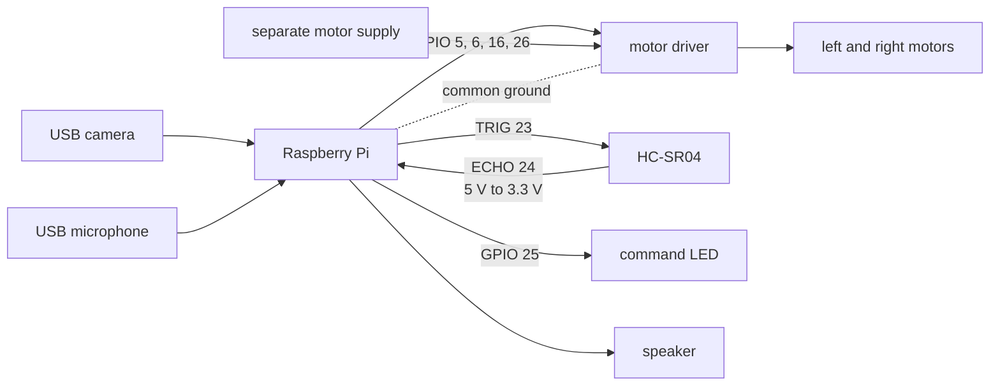

# Wiring Guide

[English](wiring.md) | [한국어](ko/wiring.md) | [日本語](ja/wiring.md)

This guide reflects the BCM pin assignments in the current `hardware.py`. Verify the motor-driver datasheet and the Raspberry Pi pinout before reconnecting the prototype.

## Wiring concept

## Current BCM assignments

| Component | BCM GPIO | Role |
| --- | ---: | --- |
| Motor IN1 | 5 | left motor direction |
| Motor IN2 | 6 | left motor direction |
| Motor IN3 | 16 | right motor direction |
| Motor IN4 | 26 | right motor direction |
| HC-SR04 TRIG | 23 | trigger output |
| HC-SR04 ECHO | 24 | level-shifted echo input |
| Command LED | 25 | command-state indicator |

These are BCM numbers, not physical header-pin numbers. Ultrasonic and LED pins are configurable through `.env`; the four motor pins are currently constants in `hardware.py`.

## Power and grounding

- Never power DC motors directly from a Raspberry Pi 5 V pin.
- Use a motor driver and a separate supply rated for motor voltage and peak current.
- Connect Raspberry Pi ground to the driver logic ground as required by the driver.
- Follow the driver datasheet instead of joining power rails by assumption.
- Provide polarity and over-current protection and an immediately accessible motor-power switch.

Battery voltage, load, and floor friction change timed-motion distance and turn angle even when the code is unchanged.

## HC-SR04 ECHO voltage

A common HC-SR04 can output a 5 V ECHO signal while Raspberry Pi GPIO uses 3.3 V logic. Route ECHO through a resistor divider or level shifter before GPIO24. The code uses a median of three readings, treats stuck-high and exceptions as 0 cm, but currently treats an ECHO-rise timeout as maximum range. One sensor is not a complete collision-avoidance system.

## USB camera and audio

The default camera index is 1 and the default audio device is `plughw:3,0`. USB enumeration can change after reconnects and reboots, so verify `CAMERA_INDEX` and `AUDIO_DEVICE` on the deployed device.

Captured JPEG files may be sent to Gemini. Limit the camera view to avoid people, documents, addresses, or private spaces.

## First-test procedure

1. Disconnect all power and verify BCM numbers, polarity, and shorts.
2. Verify ECHO voltage conversion and common ground.
3. Read distance values with motor power disconnected.
4. Raise the wheels and test one motor at a time for a very short interval.
5. Verify each direction and stop state.
6. Verify the 25 cm single-forward guard.
7. Verify the 18 cm continuous-motion stop and sensor-fault behavior.
8. Add camera and voice commands only after device tests pass.
9. Begin short floor tests in a clear area with no people nearby.
10. Keep the motor power switch within reach throughout the test.
