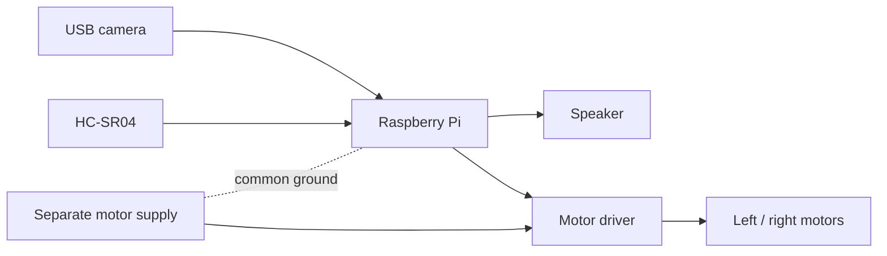

# Wiring Guide

[English](wiring.md) | [한국어](ko/wiring.md)

This is a conceptual integration reference for future hardware work. The public Python source does not configure these pins or drive the listed components.

## Conceptual Wiring

## Example BCM GPIO Map

These are example BCM numbers, not a verified map from the public code. Confirm the board pinout, motor driver, enabled interfaces, and your own wiring before implementation.

| Component | Example BCM GPIO | Purpose |
| --- | ---: | --- |
| Left motor IN1 | 17 | Direction |
| Left motor IN2 | 27 | Direction |
| Right motor IN1 | 22 | Direction |
| Right motor IN2 | 23 | Direction |
| Motor PWM A | 18 | Speed control |
| Motor PWM B | 13 | Speed control |
| HC-SR04 TRIG | 5 | Output |
| HC-SR04 ECHO | 6 | Input through voltage conversion |

## Electrical Safety

- Use a separate supply sized for the motors and driver. Do not power motors from the Raspberry Pi 5 V pin.
- Connect grounds according to the motor-driver design so control signals share a reference.
- A typical HC-SR04 ECHO output is 5 V. Use a suitable voltage divider or level shifter before Raspberry Pi GPIO.
- Add a physical motor-power switch and keep it reachable.
- Keep motor power wiring away from sensor signals where practical.
- Start with the chassis raised, low speed, short durations, and one wheel or direction at a time.

No current repository file implements this map. Wiring hardware without a reviewed GPIO adapter and code-level safety interlock is outside the supported public example.
