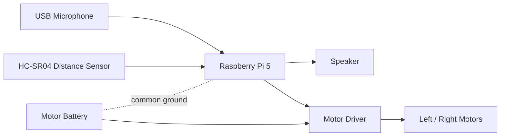

# Wiring Guide

The current code uses virtual action functions, so this guide documents the intended Raspberry Pi wiring before real GPIO code is added.

## Conceptual Wiring

## Suggested GPIO Map

Adjust these pins to match the motor driver and chassis.

| Component | Raspberry Pi Pin | Notes |
| --- | --- | --- |
| Left motor IN1 | GPIO17 | Direction |
| Left motor IN2 | GPIO27 | Direction |
| Right motor IN1 | GPIO22 | Direction |
| Right motor IN2 | GPIO23 | Direction |
| Motor PWM A | GPIO18 | PWM speed control |
| Motor PWM B | GPIO13 | PWM speed control |
| HC-SR04 TRIG | GPIO5 | Output |
| HC-SR04 ECHO | GPIO6 | Input through voltage divider |
| GND | GND | Common ground |

## Important Electrical Notes

- HC-SR04 echo is often 5V. Use a voltage divider or level shifter before connecting to Raspberry Pi GPIO.
- Motor drivers can inject noise. Keep sensor wires short and separate from motor power wires.
- Add a physical power switch for the motor battery.
- Start with low PWM values until direction and braking are confirmed.

## Implementation Gap

`hardware.py` currently prints virtual actions. The next implementation step is to replace those functions with GPIO-backed motor and sensor classes, then keep `actions.py` as the stable interface used by Gemini function calling.
